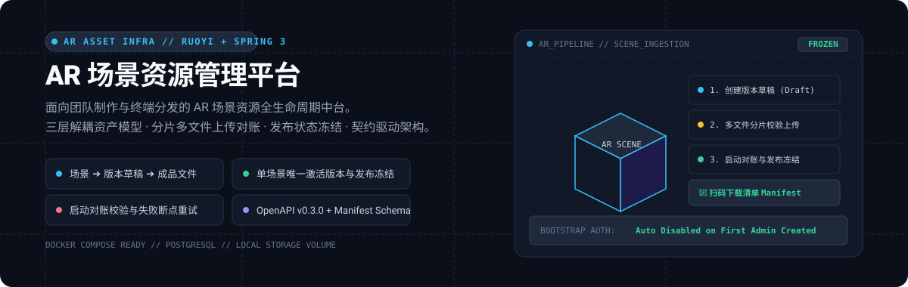

# innovation-ar-resource-platform

  

  <a href="#方案概览与资产模型"><strong>方案概览</strong></a> ·
  <a href="#核心资源入库闭环"><strong>入库闭环</strong></a> ·
  <a href="#本地运行与环境访问"><strong>本地运行</strong></a> ·
  <a href="#推荐阅读顺序"><strong>文档指引</strong></a> ·
  <a href="#契约与规范资料"><strong>契约资料</strong></a>

---

innovation-ar-resource-platform 是面向第一阶段 AR 场景展示业务建设的场景资源管理中台。

系统服务于完整的创作与分发链路：团队专业人员制作并扫描 3D / 高斯场景内容，管理员通过管理后台完成版本草稿上传、参数对账与审核发布；终端用户通过扫码快速获取对应的场景清单与成品资产并完成本地渲染。

---

## 方案概览与资产模型

平台确立了“**场景（Scene）➔ 内容版本（Version Draft）➔ 成品文件（Artifact Files）**”三层解耦的领域数据模型：

| 架构维度 | 当前设计与实现选型 |
| :--- | :--- |
| **后端架构** | 基于 RuoYi + Spring Boot 3 单体多模块架构，按业务领域职责清晰分包 |
| **数据存储** | PostgreSQL 持久化业务元数据，本地 Docker 持久化数据卷存储大文件资产；通过抽象存储接口实现解耦 |
| **内容制作** | 线下团队完成环境扫描、高斯（3DGS）重建、空间编辑与打包构建，平台负责接收与校验成品 |
| **版本发布** | 严格支持单场景单激活发布版本；支持发布替换与已发布资源只读冻结，保证客户端访问的强幂等性 |
| **后台权限** | 团队每人分配独立运维账号，具备平权管理员权限，全生命周期操作精准审计记录到人 |

> **边界说明**：当前阶段支持草稿关联多个独立文件的批量上传与校验，暂不负责在服务端深度解析拆包内部的三维模型、音频轨道或 Catalog 共享依赖。原云存储、昼夜光影切换与 AR 世界坐标系方案已留存为候选历史材料，不作为当前版本的交付基线。

---

## 核心资源入库闭环

资源入库链路遵循严格的工程一致性规范（详见 [资源入库闭环 (docs/12-resource-ingestion.md)](docs/12-resource-ingestion.md)）：

1. **创建版本草稿**：在指定场景下发起新版本草稿（Draft），隔离未完成的增量改动；
2. **多文件分片上传与登记**：支持多文件并行上传，记录文件 MD5 完整性校验值并自动关联到版本草稿；
3. **失败重试与断点恢复**：单文件上传中断或异常时支持针对性重试，不迫使全量草稿推倒重来；
4. **启动对账机制**：服务每次启动初始化时，自动核对数据库元数据与本地磁盘物理文件的存在性与完整性；
5. **发布冻结与替换**：正式发布时，将当前版本标记为唯一激活状态，旧版本平滑归档，已发布的文件元数据进入只读冻结状态，杜绝运行时篡改。

---

## 本地运行与环境访问

### 访问入口
- **本地 Vite 前端开发入口**：<http://127.0.0.1:43174>；
- **局域网 Docker Compose 访问入口**：`http://192.168.0.12:43174`（若未覆盖环境配置，Compose 默认绑定回环地址 `http://127.0.0.1:18081`）。

### 引导账号与安全机制
新数据库在首次初始化时，使用内置的 `bootstrap` 引导账号与私密配置中的一次性密码登录。**在成功创建第一个日常管理员账号后，`bootstrap` 引导账号将自动永久停用**，杜绝默认密码遗留风险。

[打开交互式汇报页面 (docs/presentation.html)](docs/presentation.html)：可在浏览器中本地打开，演示架构设计、数据拓扑与发布演进。

---

## 推荐阅读顺序

为便于全面了解项目脉络，建议按照以下顺序查阅技术文档：

1. [当前架构基线 (docs/11-current-platform-architecture.md)](docs/11-current-platform-architecture.md)：技术选型、数据库建模、后端平台与作业流定义；
2. [Docker 部署与本地存储 (docs/10-local-infrastructure.md)](docs/10-local-infrastructure.md)：容器编排启动、存储约定、验证与数据迁移；
3. [验证记录 (docs/06-validation.md)](docs/06-validation.md)：已完成的自动化检查项与已知环境验证边界；
4. [Demo 启动与维护手册 (docs/08-demo-runbook.md)](docs/08-demo-runbook.md)：原生进程运行模式与日常维护说明；
5. [上游来源与适配记录 (docs/09-upstream-adaptation.md)](docs/09-upstream-adaptation.md)：第三方依赖与基线适配边界。

---

## 契约与规范资料

- [Agent 协作流水线入口 (docs/17-agent-workflow.md)](docs/17-agent-workflow.md)
- [仓库全局知识导航 (docs/index.md)](docs/index.md)
- [基础 Harness 与自动化验证 (docs/13-harness.md)](docs/13-harness.md)
- [数据库初始化指南 (database/README.md)](database/README.md)
- [OpenAPI 接口契约规范 (contracts/openapi.yaml)](contracts/openapi.yaml)（API 契约版本为 `0.3.0`）
- [运行时清单 JSON Schema (contracts/schemas/runtime-manifest.schema.json)](contracts/schemas/runtime-manifest.schema.json) 与 [示例文件](contracts/examples/runtime-manifest.json)
- [仓库开发规范与约束 (AGENTS.md)](AGENTS.md)
