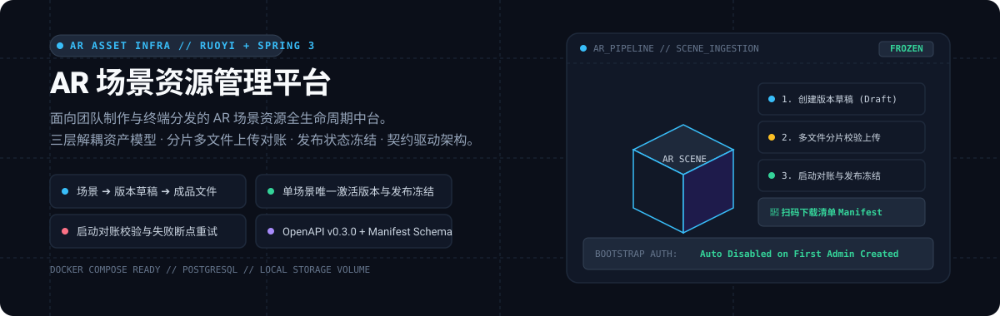

# innovation-ar-resource-platform

  

  <a href="#方案概览与资产模型"><strong>方案概览</strong></a> ·
  <a href="#核心资源入库闭环"><strong>入库闭环</strong></a> ·
  <a href="#本地运行与环境访问"><strong>本地运行</strong></a> ·
  <a href="#推荐阅读顺序"><strong>文档指引</strong></a> ·
  <a href="#契约与规范资料"><strong>契约资料</strong></a>

---

innovation-ar-resource-platform 是面向 4DGS 场景成品的资源管理与分发平台。

团队在线下采集并训练 4DGS 内容，管理员在一个场景详情内填写名称和说明、选择目录或文件并上传。全部文件校验完成后自动供客户端读取，启用/停用控制访问；换模型就新建场景。已有 4DGS 播放器按清单获取文件并自行加载，平台不解释档位、分段或模型内部结构。播放器的实际联调与设备验收需单独核对，旧参考播放器记录见 [历史样包验收](docs/20-4dgs-sample-validation.md)。

---

## 方案概览与资产模型

平台采用“**场景（Scene）➔ 文件（Scene Files）**”：一个场景直接对应一套固定模型文件，名称和说明可编辑，不再提供多版本或独立发布管理。

| 架构维度 | 当前设计与实现选型 |
| :--- | :--- |
| **后端架构** | 基于 RuoYi + Spring Boot 3 单体多模块架构，按业务领域职责清晰分包 |
| **数据存储** | PostgreSQL 持久化业务元数据，本地 Docker 持久化数据卷存储大文件资产；通过抽象存储接口实现解耦 |
| **内容制作** | 线下团队完成环境扫描、高斯（3DGS）重建、空间编辑与打包构建，平台负责接收与校验成品 |
| **资源可用性** | 全部文件校验通过即对外可用；停用后拒绝新的客户端请求；上传完成不会覆盖管理员的停用决定 |
| **后台权限** | 团队每人分配独立运维账号，具备平权管理员权限，全生命周期操作精准审计记录到人 |

> **边界说明**：场景文件清单固定（相对路径、大小、SHA-256），模型更新新建场景；ZIP 原样保存。当前仍为管理员、本地存储和单业务实例，OSS/CDN、普通用户、审核、社交与 GPU 调度留待后续阶段。

---

## 核心资源入库闭环

资源入库链路遵循严格的工程一致性规范（详见 [资源入库闭环 (docs/12-resource-ingestion.md)](docs/12-resource-ingestion.md)）：

1. **创建并上传**：同一次请求登记名称、说明和完整文件清单，重复请求可复用场景；
2. **逐文件校验**：流式核对实际大小和 SHA-256，无覆盖提交后才标记可用；
3. **按文件恢复**：重传失败或未完成文件，已入库文件跳过；当前不提供上传分片续传；
4. **上传即发布与启停**：服务端确认非空清单全部就绪后，启用的场景自然对客户端可见；
5. **整场景删除与恢复**：清理所有模型文件，失败可续做，启动先恢复删除再恢复上传，保留审计和最小回执。

---

## 本地运行与环境访问

### 访问入口
- **本地 Vite 前端开发入口**：<http://127.0.0.1:43174>；
- **日常云端 Docker Compose 网关**：`http://81.71.154.125:18081`；推荐公网入口 <https://4dgs.elma-gohan.xyz> 经 `elma-gohan.xyz` 的 nginx 转发到云端，不再依赖开发机或反向 SSH 隧道。本机原 `192.168.0.12:18081` 应用已停止，数据卷保留。2026-10-30 仅迁移账号，云端不含本机原场景和文件；
- **隔离验收实例**：`http://127.0.0.1:18082`，仅用于验证，不操作日常实例。Compose 未配置时的默认值仍是 `127.0.0.1:18081`，不是当前日常绑定。

### 引导账号与安全机制
新数据库在首次初始化时，使用内置的 `bootstrap` 引导账号与私密配置中的一次性密码登录。**在成功创建第一个日常管理员账号后，`bootstrap` 引导账号将自动永久停用**，杜绝默认密码遗留风险。

[历史交互式汇报页面 (docs/presentation.html)](docs/presentation.html)：保留早期昼夜、草稿与对象存储候选设计，不作为当前功能说明。

---

## 推荐阅读顺序

为便于全面了解项目脉络，建议按照以下顺序查阅技术文档：

1. [当前架构基线 (docs/11-current-platform-architecture.md)](docs/11-current-platform-architecture.md)：技术选型、数据库建模、后端平台与作业流定义；
2. [Docker 部署与本地存储 (docs/10-local-infrastructure.md)](docs/10-local-infrastructure.md)：容器编排启动、存储约定、验证与数据迁移；
3. [验证记录 (docs/06-validation.md)](docs/06-validation.md)：已完成的自动化检查项与已知环境验证边界；
4. [Demo 启动与维护手册 (docs/08-demo-runbook.md)](docs/08-demo-runbook.md)：原生进程运行模式与日常维护说明；
5. [上游来源与适配记录 (docs/09-upstream-adaptation.md)](docs/09-upstream-adaptation.md)：第三方依赖与基线适配边界。
6. [客户端接口](docs/21-client-api.md) 与 [Unity 对接](docs/22-unity-integration.md)：匿名目录、详情、Range 下载和客户端集成边界。

---

## 契约与规范资料

- [Agent 协作流水线入口 (docs/17-agent-workflow.md)](docs/17-agent-workflow.md)
- [仓库全局知识导航 (docs/index.md)](docs/index.md)
- [基础 Harness 与自动化验证 (docs/13-harness.md)](docs/13-harness.md)
- [数据库初始化指南 (database/README.md)](database/README.md)
- [OpenAPI 接口契约规范 (contracts/openapi.yaml)](contracts/openapi.yaml)：管理员场景文件与匿名读取接口，以本地生成源对应版本为准；本地接口更新不代表日常服务已升级。
- [历史运行时清单 Schema](contracts/schemas/runtime-manifest.schema.json)（候选资料，不再生成）
- [仓库开发规范与约束 (AGENTS.md)](AGENTS.md)
