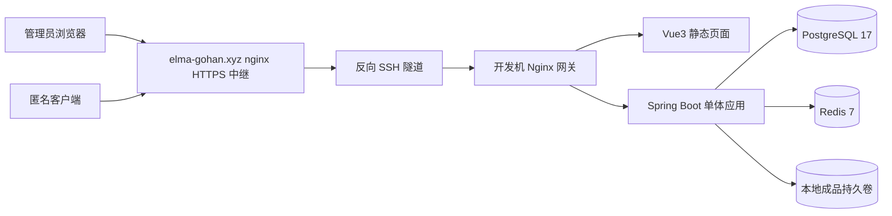
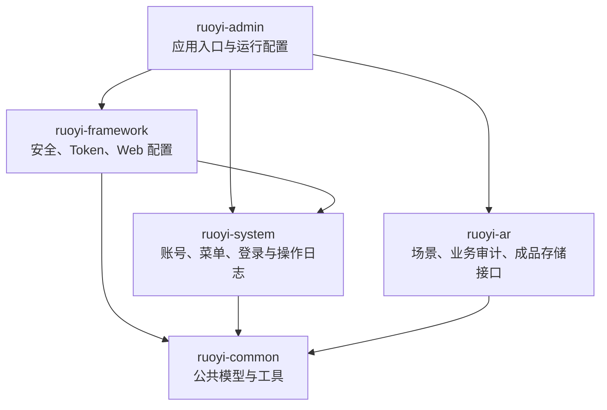
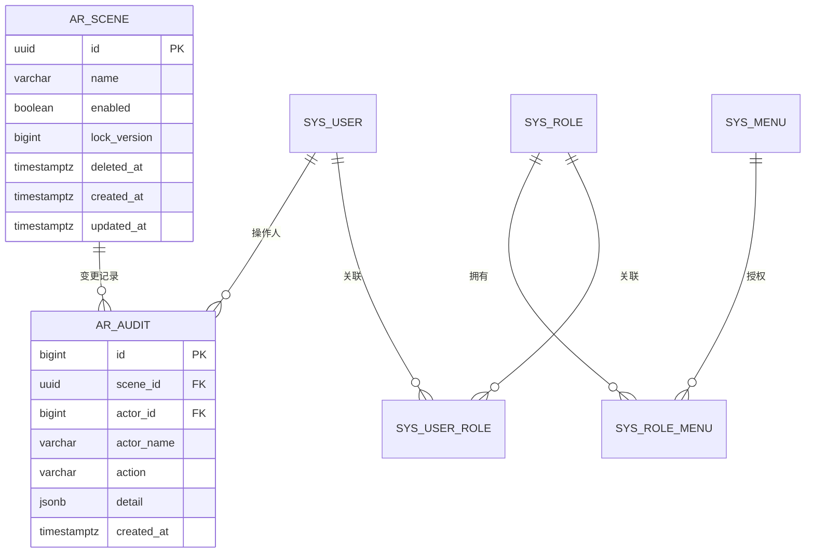
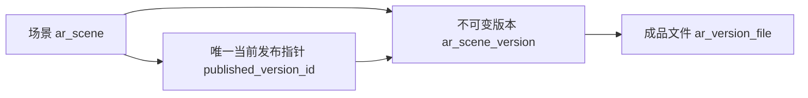
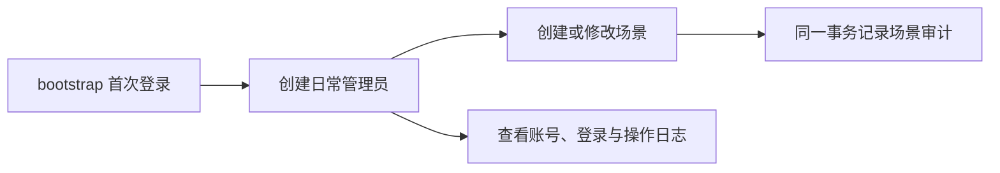
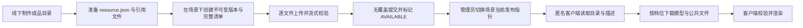

# 当前 4DGS 场景资源平台架构

本文记录现行技术选型、数据边界和内容作业流；具体接口与状态以 [资源入库闭环](12-resource-ingestion.md) 和 [客户端接口](21-client-api.md) 为准，不把历史候选设计当作当前规格。

平台接收线下制作的 4DGS 成品：在场景下导入带 `resource.json` 的目录，创建不可变版本，逐文件上传校验，再发布为该场景唯一当前版本。匿名客户端可读取目录、详情和文件，并用 `scripts/download_scene.py` 按档位完整下载。三份真实样包的导入、发布、读取与下载，以及桌面 Chrome 参考播放器的三项播放已在隔离实例验收；手机、Unity 原生加载及音频未验证，见 [真实样包验收记录](20-4dgs-sample-validation.md)。

## 已确定的架构边界

- 平台采用一个 Spring Boot 应用，不拆分微服务，也不增加任务队列或独立 Worker。
- PostgreSQL 保存业务数据和文件元数据，本地持久卷保存成品文件。数据库不保存文件内容、Windows 盘符、容器绝对路径或永久下载地址。
- 场景、内容版本和成品文件保持分离。一个场景对应一个独立 4DGS 成品，关联多个不可变内容版本，一个版本关联描述声明的多个文件；不解析模型内部或共享依赖。
- 算法处理和客户端渲染不进入后端。后端不调度扫描、重建或资源构建任务。
- 管理后台使用独立账号，当前账号具有相同管理员权限。系统不包含租户、审批角色或公开注册。
- 当前应用运行在开发机的本地 Compose，通过反向 SSH 隧道和 `elma-gohan.xyz` 的 nginx 提供公网 HTTPS 演示入口；这不是云端应用部署。对象存储、CDN、高可用和自动备份尚未实施。

## 技术选型

| 层次 | 当前选择 | 使用范围 |
|---|---|---|
| 管理后台 | Vue 3.5.26、Vite 6.4.1、Element Plus 2.13.1、Axios 1.13.2 | 登录、账号、场景和日志页面 |
| 网关 | Nginx 1.28.0 Alpine | 提供前端静态资源，将 `/prod-api/` 和匿名客户端读取 `/api/v1/client/` 转发到后端 |
| 后端 | Java 21、Spring Boot 3.5.16、RuoYi 3.9.2 | HTTP 接口、鉴权、业务事务和文件存储抽象 |
| 数据访问 | MyBatis 3.0.5、Druid 1.2.28 | PostgreSQL 查询、写入和事务管理 |
| 数据库 | PostgreSQL 17.6 | 账号、菜单、日志、场景和业务审计 |
| 数据库迁移 | Flyway | 按版本初始化和演进数据库结构 |
| 登录状态 | Spring Security、Bearer Token、Redis 7.4.5 | 保存短期登录状态并校验账号凭证版本 |
| 成品存储 | `ArtifactStorage`、Docker 本地命名卷 | 暂存、摘要校验、确认入库、读取和盘点 |
| 部署 | Docker Compose、Linux 容器 | 开发机日常演示与隔离验收；原生 Windows 工具另行保留 |

这套选型沿用现有若依后台的账号、菜单和日志能力，同时把项目业务集中在 `ruoyi-ar` 模块。当前业务规模不需要引入分布式组件。文件存储通过接口隔离，后续需要更换存储方式时，可以保留业务层的文件标识和状态定义。

## 部署架构

Docker Compose 管理 `gateway`、`backend`、`postgres` 和 `redis` 四个服务。日常网关绑定 `http://192.168.0.12:18081`，公网入口为 `https://4dgs.elma-gohan.xyz`；开发机或隧道离线即不可用。隔离验收只绑定 `127.0.0.1:18082`，Vite 开发入口为 `127.0.0.1:43174`，不能混用数据库与账号。只有网关映射宿主端口，PostgreSQL、Redis 和 Spring Boot 只在容器内部网络中通信。

网关同时连接 `edge` 和 `services` 网络，其他服务只连接 internal 类型的 `services` 网络。Nginx 不挂载成品卷，`/artifacts`、`/_artifacts`、`/staging`、`/committed` 和 `/data` 等内部路径直接返回 404。客户端读取由后端先判断场景、版本和文件是否可以访问，再流式输出已发布文件，不能开放原始目录。

PostgreSQL、成品、框架文件和后端日志分别使用命名卷。Redis 的 `/data` 使用 tmpfs，容器重启后登录状态失效，用户需要重新登录。应用配置和随机凭据保存在忽略提交的 `config/compose.env`，不会写入镜像。

## 后端平台架构

后端使用模块化单体结构。所有业务模块由一个 Spring Boot 进程加载，模块用于划分职责，不代表独立服务。

`ruoyi-admin` 负责应用启动、环境变量和 Flyway 迁移。`ruoyi-framework` 配置 Spring Security、Bearer Token、异常响应和 MyBatis 扫描。`ruoyi-system` 管理固定角色账号、菜单、登录日志与操作日志。`ruoyi-ar` 提供场景接口、场景业务审计和 `ArtifactStorage` 存储抽象。

当前安全配置只允许已经实现的接口通过。登录和验证码接口允许匿名访问；账号、日志、场景及场景审计接口要求管理员登录；`/api/v1/client/` 下恰好三个只读路由（目录、描述 GET，文件 GET/HEAD）逐条允许匿名，该前缀下其他路径和所有写方法不放行；其他请求默认拒绝。若依框架接口继续使用 `code/msg` 响应，`/api/v1` 业务接口使用真实 HTTP 状态和 `code/message/traceId` 错误结构。

首次部署使用 `bootstrap` 引导账号。管理员创建第一个日常账号以后，引导账号自动停用。日常账号统一关联固定管理员角色。密码长度为 6–64 个字符，系统禁止停用最后一个有效管理员。密码或账号状态发生变化时，数据库递增 `credential_epoch`，后端在每次请求中核对该版本，使旧 Token 失效。

账号列表支持确认后删除，通过 `DELETE /system/user/{id}` 将 `del_flag` 设为 `2` 并停用账号，保留账号行、场景审计和历史日志。旧登录凭证失效，账号不能重新启用或重置密码，已使用的账号名不重复使用。删除与账号启停共用固定角色行锁，禁止删除最后一个有效管理员及当前登录账号。已停用的引导账号可由其他管理员删除，删除操作记录在系统操作日志中。

## 数据库架构

当前 Docker 环境只加载 `classpath:db/demo` 下的 Flyway 迁移。根目录 `database/migrations` 保存旧七表候选设计，不参与应用初始化。

数据库可以分为框架数据和当前业务数据两部分：

| 数据范围 | 主要表 | 当前职责 |
|---|---|---|
| 账号与权限 | `sys_user`、`sys_role`、`sys_menu`、`sys_user_role`、`sys_role_menu` | 管理员、固定角色和后台菜单 |
| 登录与系统日志 | `sys_logininfor`、`sys_oper_log` | 登录结果和已接入的后台管理操作 |
| 框架配置 | `sys_config`、字典、部门及其他若依基础表 | 支撑后台框架运行 |
| 场景 | `ar_scene` | 场景名称、启用状态和并发版本号 |
| 场景审计 | `ar_audit` | 记录场景变更的操作人、动作、时间及变更内容 |
| 内容版本 | `ar_scene_version` | 场景内版本号、请求键、不可变描述和可编辑说明 |
| 成品文件 | `ar_version_file` | 固定相对路径、预期大小/摘要、上传状态与已验证结果 |
| 整版删除 | `ar_version_deletion` | 删除意图、失败原因与最小幂等回执 |

以下 ER 图仅展示账号、场景和审计；内容版本与文件关系见下一节及 V015 迁移。

`ar_scene.lock_version` 用于乐观并发控制。修改场景时，客户端必须提交读取到的版本号；版本号过期时返回 409，防止后提交的请求直接覆盖他人的修改。场景只维护名称、启用状态和版本号，V014 迁移已删除地址、经纬度和坐标类型。

场景列表支持删除，操作前弹出包含场景名称的确认窗口。`DELETE /api/v1/scenes/{id}?expectedVersion=...` 需要登录，成功返回 204。V006 迁移增加 `deleted_at`，用于逻辑删除；已删除场景不再出现在列表和详情中，也不能修改或启用。删除沿用修订号检查，并在同一事务内写入 `DELETE` 审计，保留历史记录。

场景修改与 `ar_audit` 写入处于同一个数据库事务中。审计表通过触发器禁止更新和删除，业务变更和审计记录不能只提交其中一项。账号表通过触发器维护 `credential_epoch`，密码或启用状态变化后，已经签发的 Token 不能继续使用。

数据库中的时间字段使用 `timestamptz`，应用和容器使用 UTC。页面展示时再根据客户端时区处理。

### 当前内容数据边界

- 场景业务信息只有名称，另维护启停、修订号、时间/删除信息与发布指针；没有地点、昼夜或入口标记模型。
- 创建版本时固定 `resource.json` v1 描述和完整文件清单，只有说明可编辑；修改模型、档位、时间或配置需要新建版本。
- 描述声明档位、有序分段、变换及公共配置/媒体路径。路径集合必须恰好等于文件清单；后端不解码模型或推断分段时间。
- V015 清洁切换删除旧业务表并清空旧成品记录，保留账号与菜单。不得未经授权升级日常数据库。当前模型、限制和状态详见 [资源入库闭环](12-resource-ingestion.md)。

## 本地成品存储

`ArtifactStorage` 定义入库、恢复、读取、大小、删除和盘点操作。首个实现 `LocalArtifactStorage` 使用同一个本地文件系统中的 `staging`、`committed` 和 `locks` 目录。

1. `store` 先生成 `<uuid>.part`，边读取边计算文件大小和 SHA256，同一份字节只计算一次。
2. 校验通过以后，文件原子重命名为 `<uuid>.ready`，再通过硬链接生成 `committed/<uuid>.bin` 并删除 `.ready`。校验失败或输入中断时，不会生成正式文件；正常成功后不重读内容。
3. 同一个 UUID 已有完整且校验通过的字节时只验证一次并复用。内容不符时存储组件拒绝覆盖；尚未确认可用的上传会删除这份未确认遗留后再接收新正文。
4. `recover` 只用于完成中断的写入：对遗留的 `.bin`/`.ready` 至多验证一次；只有 `.part` 返回 false。
5. 服务重启后可以盘点 `.part`、`.ready` 和 `.bin`，识别未完成的操作。组件不会自行删除正式文件，也不会根据文件存在推断业务版本已经发布。

文件系统与数据库事务不能组成同一个原子事务。版本服务先登记完整清单和文件处理状态，成功 `store` 后补记 `AVAILABLE`；启动时先恢复整版删除，再仅对有遗留字节的未完成文件调用 `recover`。已可用文件不全量重算摘要；文件进入 `committed` 仍不等于该版本已经发布。

## 当前管理作业流

首次部署后，团队使用私密配置中的引导密码登录。创建第一个日常管理员以后，`bootstrap` 停用。管理员可以创建、修改、启用或停用场景，并查看场景操作记录。账号管理动作写入若依操作日志，登录结果写入登录日志；场景业务变化单独写入 `ar_audit`。

## 当前内容作业流

### 成品交付

算法工作站只负责生产交付物，不直接写入平台存储目录。首期通过管理后台人工上传，上传接口保持独立，后续可以由工作站脚本复用。后端根据客户端提交的预期大小和 SHA256 校验实际文件，不能只相信请求元数据。

资源入库先一次登记版本及其全部文件清单（描述引用路径必须与清单一致）；原始文件在接收时一次完成大小与 SHA256 校验，并无覆盖提交为正式文件后，数据库才标记可用。文件校验、文件确认和数据库状态提交需要支持重复请求。服务重启以后，平台根据数据库状态和存储盘点结果只处理未完成记录，不通过后台队列继续未知任务。

### 发布与整版删除

发布要求描述引用有效、全部文件 `AVAILABLE` 且没有上传或删除操作；切换时比较 `expectedSceneVersion`，过期返回 409。目标已是当前发布版本时返回原结果，不更新指针、时间、修订号或审计。没有预览审批状态、冻结操作或单独下线接口；后台内嵌预览未提供，参考播放器是另行准备的联调入口。

替换发布后旧版本保持内容不可变，管理员仍可查看或整版物理删除，也可重新发布仍完整的旧版本。当前发布版本禁止删除。删除先持久化意图，再删除全部存储文件和业务行，保留审计与最小回执；失败返回 503，可重试或由启动恢复完成。客户端只读取当前发布版本：已开始的字节流可完成，后续旧版本请求返回 409，不允许拼接新旧内容。

### 客户端获取

匿名客户端不登录管理账号，只能读取已启用、未删除场景的当前发布版本：`GET /api/v1/client/scenes` 目录、`GET /api/v1/client/scenes/{sceneId}` 描述与完整文件清单（含大小、SHA256、content type 和下载地址）、`GET/HEAD .../versions/{versionId}/files/{fileId}/content/{fileName}` 文件流。客户端先固定版本，只下载选定档位和公共文件，校验摘要后交给本地渲染模块；发布版本变化后旧版本地址返回 409，客户端须重新取描述。细节见 [资源入库闭环](12-resource-ingestion.md)。

客户端文件由后端判定可见性后流式输出，Nginx 只做同源代理（`/api/v1/client/`，关闭缓冲），支持单段 HTTP Range、If-Range 与强 ETag。读取仅检查记录、文件存在和长度，不重算 SHA256；同长度损坏由下载端校验发现。参考工具已验证中断续传、200 截断重写、损坏不就绪与版本变化 409，真实样包结果见 [验收记录](20-4dgs-sample-validation.md)。服务端不能收回客户端已经下载的内容。

## 异常处理原则

| 情况 | 处理原则 |
|---|---|
| 上传中断 | 该文件保持未完成或失败；查询状态后只重传此文件，已完成文件跳过 |
| 大小或摘要不符 | 返回 422，保存失败原因，不确认可用 |
| 存储 I/O 失败 | 返回 503，保存失败状态，可重试 |
| 文件已确认、数据库未提交 | 启动恢复仅验证该未完成文件的遗留字节，至多一次后补记状态 |
| 已记录可用、文件缺失或长度不符 | 下载返回 409；同长度损坏由客户端摘要校验发现 |
| 并发编辑或发布 | 使用 `lock_version` 检查，过期请求返回 409 |
| 发布内容有误 | 切换回已确认的历史版本，不覆盖当前文件 |
| Redis 重启 | 登录状态失效，管理员重新登录 |
| PostgreSQL 或存储不可用 | 保留当前发布状态，不继续提交新状态 |

## 部署与迁移

当前在开发机运行 Linux 容器，原生 Windows 工具不作为 Linux 启动入口。以后迁移到独立服务器仍需保留 Compose 服务关系、私有配置和卷数据，不复制容器可写层；当前公网隧道不能当作已完成物理迁移。

迁移时先停止网关和后端写入，通过 `pg_dump` 导出 PostgreSQL，再复制成品卷并记录相对路径、大小和 SHA256。目标环境恢复数据库和文件以后，需要核对场景、审计、文件摘要和发布关系，再使用真实客户端完成加载测试。源环境在验收完成以前保持停止并保留数据，以便迁移失败时退回。

当前只验证了命名卷在容器重建以后继续保留数据。物理主机迁移、备份恢复、磁盘写满、断电和多设备并发尚未验收。

## 当前状态与未验证边界

当前已实现场景与账号管理、审计、`resource.json` 不可变版本、逐文件上传/恢复、单一发布指针、匿名读取/Range 下载和整版物理删除。参考工具与桌面播放器的已验收范围见 [真实样包验收记录](20-4dgs-sample-validation.md)，不以历史 quick 或 SQL 报告替代当前业务验证。

后台内嵌预览、单独下线、对象存储、CDN、共享依赖与 catalog 解析未实现；手机/Unity 原生解码、手机网络和音频同步未验证。云主机挂盘与 CDN 仍是 [后续分发建议](19-public-resource-delivery-proposal.md)，不是当前隧道演示的组成部分。
