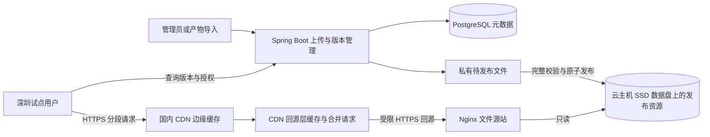

# 深圳试点资源传输与存储架构建议

日期：2026-10-23（Asia/Singapore）。状态：已确认试点约束，架构与容量方案待批准实施。未开通云资源、未部署、未压测。

> 本页保留 2026-10-23 的云主机/CDN 方案，尚未实施，不描述当前部署。现行版本、匿名读取和完整下载见 [资源入库闭环](12-resource-ingestion.md)；当前公网演示是开发机经反向 SSH 与 nginx 中继提供的 HTTPS，区别于本页建议的云端文件源站与 CDN。

## 当前口径与变更原因

用户明确：主要面向中国大陆公网，深圳作为首期试点；使用国内云服务器及其挂载硬盘存放成品，短期不使用对象存储，但预留未来接入；客户端未定，最终格式可能与 4DV 不同，产物体量可参考现有样本。重视长期并发、流量和 4DV 的分段加载经验。

此口径替代本页上一版“立即使用对象存储、云 SDK 直传”的建议。对象存储不作为试点前置条件。当前仍是方案准备，不是实现、采购、压测或部署授权。

## 建议架构

保留 Spring Boot、PostgreSQL、Vue 管理后台及本地存储实现。新增受控的已发布资源分发边界：Nginx 从只读发布资源目录直接响应 CDN 回源，模型字节不通过 Java 业务请求搬运。业务接口提供版本查询和访问授权。

可先部署在一台云主机内，分离 Nginx 文件服务和业务进程的职责；这不等于已经实现主机级高可用。源站故障时缓存未命中的资源、新内容和业务接口仍可能不可用。CDN 缓存不能代替磁盘备份；需要数据盘/数据库备份与恢复演练，不能声称单机容灾已完成。

建议数据盘与系统盘分开，按磁盘吞吐、容量和恢复要求选择 SSD 云盘；Nginx 只读发布资源，不能把整个 committed 目录公开，因为其中还包含未发布内容。发布映射必须先确认完整性、再切换引用，不让 CDN 读取半成品。后台上传、摘要巡检与预热要控制并发，避免争用源站磁盘和出口；当前平台不提供 ZIP 导出。

普通 CDN 支持公网 IP 或域名作源站，无需先购买对象存储。当前网关未挂载资源卷，文件仍经 Java 流式输出，因此此图是待实施方案，不能把现有 Compose 当作已经支持该链路。

## 4DV 的可借鉴做法与边界

证据来源为 `/home/elma/文档/ChatGPT/前端4DGS调研/` 中固定构建 `20261016230726-5a40c21` 的发布文件、读码笔记和模型样本；本轮复读相关报告与部分引擎源码，不声称重新抓取或实测最新线上版本。

- 多数样本预先切为约 5 秒独立模型文件。普通模型分段加载走完整段的流式 fetch，后台 Worker 边接收边解码；不是靠任意字节切割就得到可播放模型。
- 三个逻辑窗口分别为当前渲染、已准备好、正在加载；当前窗口激活后预取下一窗口，GPU 前后两组资源交换。
- 内容按档位生成不同模型，段文件可缓存，应用具有本地 Cache Storage。代码还包含独立的整部内容后台缓存预取，因此不能把其总网络流量简单描述为只下载当前与下一段。
- 已分析构建没有根据带宽自动切换模型档位。Render Quality 的自动降低针对画布分辨率，不减少模型下载字节。不能把它描述成 HLS/DASH 式自适应码率播放器。
- 本地 localhost 路径跳过模型缓存/后台预取，研究目录里的回环演示不能直接证明公网缓存行为。
- 约 5 秒分段可以作为首次对照参数，不是永久格式要求。短段可能增加头部、跨段点和静态背景重复，总流量需要实际比较。
- 引擎整体存在 Range 探测和 AbortController，例如容器探测/解包路径；“模型逐段完整 fetch”只描述已分析的普通分段主路径，不代表整个播放器完全不用 Range。

可直接学习分段、有限窗口、解码排序后台化和缓存分层。整部预取、固定手机档位、缓存上限及重试节奏需要按本项目流量预算/设备验证，不能因厂商经验而自动作为我方验收结论。其业务并发、服务合同和源站内部拓扑尚无证据。

## 分段和带宽的关系

分段减小开始播放前必须加载的数据、限制驻留内存、支持 seek 和按需请求；不自动减少完整播放总字节，也不会把低速网络变快。HTTP Range 是一个文件内的字节读取能力，模型时间分段是内容生产/组织能力，两者独立。

以下只是算式示例，MB 为十进制，不是容量承诺：25 MB 的分段对应 5 秒内容，平均模型数据率为 40 Mbps。10 Mbps 有效下载速度至少需 20 秒传完；100 Mbps 至少需 2 秒。实际还有首字节、抖动、解码、排序和 GPU 上传。能否及时切换取决于整条加载路径是否赶上缓冲期限，而不只看平均吞吐。

固定约 5 秒分段是便于对照的起点；通过低档资源、只预取必要窗口、限制非必要下载和重试降低需求。是否增加带宽估计与自动选档，需要播放器实现和业务选择，不归入后端默认能力。

## 三条链路分别预算

| 链路 | 主要压力与措施 |
|---|---|
| 管理员到源站 | 上传成功率、上行与校验耗时；保留本地流式上传，公网大文件续传按需要用成熟协议设计，不因暂不上 OSS 而自造一套复杂传输协议 |
| 源站到 CDN | 冷缓存、缓存过期、随机 seek、新版本和预热产生的回源；靠可缓存的不可变文件、回源层、合并回源、分批预热及足够云主机出口控制 |
| CDN 到用户 | 用户规模、档位、运营商与终端网络；由 CDN 下发，终端网络不足仍会缓冲，流量仍计费 |

首期云主机公网带宽不能凭 CPU/内存配置决定，也不能拿内网网卡速率当公网出口。即使同云厂商 CDN 回源 ECS，也不能未经产品说明就假定走免费内网；源站公网带宽/流量和 CDN 下行分别预算。

稳定负载下的粗估：源站平均回源带宽约等于 CDN 用户侧字节速率 × 未被 CDN 缓存消化的字节比例。必须使用字节口径，并以源站实测核对；预热、分层缓存、重复填充和冷启动会使该简化估算失准。

例：1000 人 × 40 Mbps = 40 Gbps 用户侧持续速率。若实际字节卸载比例为 95%，约有 2 Gbps 回源；99% 仍约 400 Mbps。不能只说“命中率很高，所以小带宽足够”。冷启动则由同时请求的不同内容、实际回源节点组、合并效果和填充时限单独决定。

现有 4DV 样本的普通档约 19.7–55.1 Mbps、所选高清最高约 188 Mbps，均按模型大小/时长推算，未计媒体与预取。256 个模型文件中位 23.48 MB、P90 102.84 MB、最大 445.01 MB。这些数据用于压力样本选择，不作为我方最终成品强制上限。

## 高并发现在要做什么

1. **分离业务和文件读取。** 当前 `SceneVersionService` 的目录/详情/发布不读模型字节，文件 GET/HEAD 只检查记录、存在和长度，不再有旧 `DraftService.completeFiles()` 的全集合重算。后续 CDN 方案仍需受控发布映射，不直接公开私有目录；下载端 SHA256 能发现同长度损坏，但完整性巡检与隔离处置须另行设计和验收，不能声称现已具备。
2. **保护缓存复用。** 固定内容标识和版本路径，模型长缓存，当前版本查询短缓存或不缓存。CDN 先鉴权，再按经过验证的缓存规则共享同内容；不要因每个用户签名不同而产生无数副本，也不能为了命中绕过鉴权。
3. **冷启动保护。** 验证厂商的中间层和合并回源能力，不能假定默认开启。合并作用于同一缓存节点/层的同一资源请求，不是全网只下载一次；不同资源仍需各自回源。源站返回真实 Content-Length，避免不必要传输压缩/转换，检查 200/206 与缓存配置是否符合合并条件。
4. **受控预热。** 为发布版本的试点档位预热，优先封面、设置、首段和紧接分段；已知活动完整内容可分批预热。预热本身会占源站出口。常规预热多先到回源层，不保证所有深圳边缘节点立即命中。
5. **过载行为。** API 按操作限流，文件出口留出余量，播放器限制无效请求和重试并发；源站达到阈值时限制新会话/提示稍后开始等策略需用户确认。不要为“降级”把所有 CDN 失败请求直接切到同一源站公网 IP，否则会放大故障。每 IP 限制需考虑多个用户共用运营商出口，不能据此简单判定攻击。
6. **指标。** 监测业务 API 延迟/错误、CDN 字节命中和回源量、源站网络出口/读盘/连接数、用户首帧、缓冲时间、分段准备时间及播放下载字节。带宽和费用告警不能代替已经验证的容量或硬预算控制。

增加存储集群、全国多源站、微服务拆分、Kubernetes、多云双写和未使用的 OSS 实现均不作为本阶段工作。若用户要求源站故障时仍保障所有内容，需另立可用性目标并设计冗余，单机加 CDN 不能提供该承诺。

## 深圳试点如何定义与验收

深圳首先是用户和验收地域。标准 CDN 通常选择中国内地等加速范围，再由厂商按地域、运营商和负载调度；不等于购买或指定深圳全部节点。需要深圳电信、联通、移动及 Wi-Fi/蜂窝网络的实际探测；若要求强制只落深圳节点，必须单独向厂商确认能力和合同。

并发容量现在就定义测试方法，但不能在未知云主机出口、实际码率和缓存效果时承诺人数。可按 10→50→100→更高并发逐级验证，这是测试阶梯，不是已支持人数；压测和计费流量需另行授权。

至少分别测试：

- 热缓存同一内容：验证 CDN 下发和终端网络。
- 冷缓存同一内容集中进入：验证合并回源和首批分段准备。
- 多内容冷访问、随机 seek、切档：验证低命中与回源峰值。
- 新版发布与旧会话并行：不能混版本，不能全量清缓存导致瞬时回源。
- 上传/校验与播放同时发生：验证同盘、同主机资源争用。
- 源站慢、文件缺失、签名过期：错误明确，重试有界，不绕过权限或直接回退打源站。

预热状态、单机压测和全国节点覆盖都不能代替深圳三网实际体验。上线前核实 CDN 的突发容量/压测报备和域名要求；官方产品存在突发限流规则，CDN 不是未经确认的无限容量承诺。

## 如何预留对象存储

现在只维护必要边界：数据库存稳定资源标识、相对存储键、大小和摘要；磁盘绝对路径留在本地存储层；客户端只认识统一资源域名与版本路径。继续使用已有 ArtifactStorage，但不编写没有实际用途的 OSS 空实现、自动回退或永久双写。

后续迁移时：复制文件并核对摘要，保持已发布资源键与清单关系，验证权限/缓存，再切 CDN 源站。上传直传与 multipart 的会话模型届时另行实施，不能承诺靠改一个配置即可完成。磁盘容量、备份恢复成本、回源带宽、可用性要求或运维负担成为瓶颈时再评估迁移，不以单一并发人数作为阈值。

## 下一步建议与证据边界

先出具体实现计划：发布资源不可变与只读映射、Nginx 文件源站、CDN 缓存/鉴权/回源条件、播放器分段消费和度量、深圳三网试点及容量测试。用户批准后才编码、采购或部署。

平台基线为 `31aa80be2ac439bfdc6348e96af1d470d611b10a`；本地方案分支 `codex/4dgs-format-discovery`。真实样本核查见[任务记录](tasks/active/2026-10-23-4dgs-format-discovery.md)。本轮只读报告、源码和官方资料并更新文档，未更改业务源码或服务状态。

本地依据：`docs/4DV整体技术选型与架构思路.md` 第 5、6.1、6.10–6.11 节，`docs/4DV原始素材到手机播放全链路研究报告.md` 第 12–13 节，以及 `evidence/runtime-analysis/分段调度与缓存.md`，均位于用户给定的调研目录。源码关键词定位仅核对相关路径，未重新执行播放器或重新测量公网表现。

官方依据（2026-10-23 核对）：

- [阿里云 CDN 源站配置](https://help.aliyun.com/zh/cdn/user-guide/configure-an-origin-server/)：支持 IP/域名源站及源站流量单独计费。
- [阿里云 CDN 加速区域](https://help.aliyun.com/zh/cdn/user-guide/change-the-accelerated-region)：标准加速区域粒度。
- [阿里云节点调度说明](https://help.aliyun.com/zh/cdn/product-overview/competitive-advantages-of-alibaba-cloud-cdn/)：地域和运营商参与节点调度。
- [阿里云 CDN 预热](https://help.aliyun.com/zh/cdn/user-guide/refresh-and-prefetch-resources)：默认预热到回源层，不保证全部 L1 立即命中，预热占源站带宽。
- [腾讯云合并回源](https://cloud.tencent.com/document/product/228/81537)：功能默认关闭；GET、状态码、缓存头、Content-Length 和压缩等影响合并条件。这里只作为选型验证参考，不表示已选腾讯云。
- [阿里云 CDN 功能](https://help.aliyun.com/zh/cdn/product-overview/product-function-node-cdn)：缓存标识、回源层与资源分发能力。
- [阿里云使用限制](https://help.aliyun.com/zh/cdn/product-overview/limits)：突发容量报备与限流边界。

本轮 `git diff --check` 及新增文件的 `git diff --no-index --check /dev/null <文件>` 无空白错误。`python3 scripts/harness.py doctor --profile quick`、`python3 scripts/harness.py check --profile quick` 仍因缺少 contract validators 返回 blocked（退出码 2）；报告为 `.local/harness/20261023T130741Z-hvp1938k/report.json` 和 `.local/harness/20261023T130741Z-vx97jqjh/report.json`。未安装依赖，未运行云链路或并发验收。
