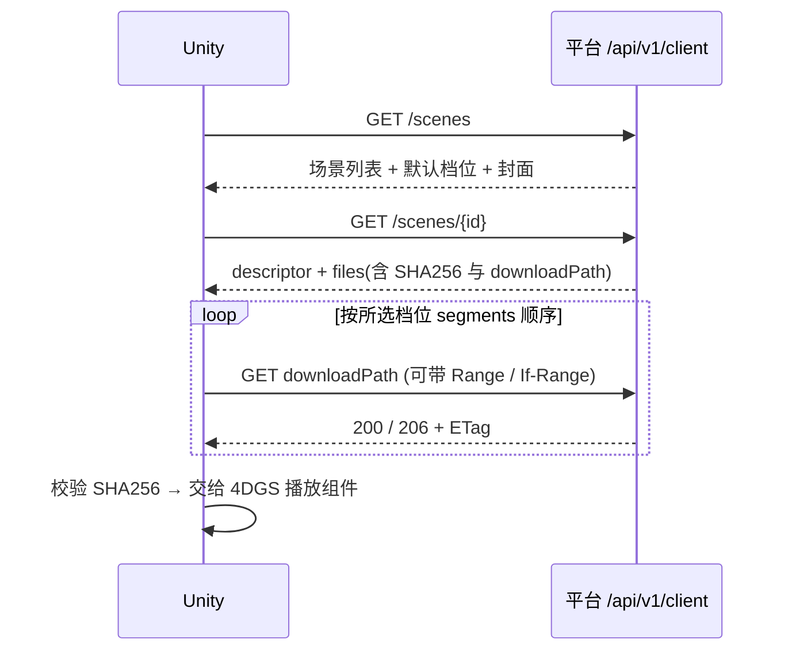

# Unity 对接技术文档

读者：Unity 客户端同事。先读 [客户端接口对接文件](21-client-api.md) 了解接口、描述字段和状态码；本文讲客户端怎么用这些接口，以及 4DGS 资源在 Unity 侧怎么组织。**手机端和 Unity 原生解码尚未在真机验证**，下面凡标“待验证”的都需要你们实测。

## 1. 平台提供什么，不提供什么

提供：场景目录、场景描述（档位、分段时间、变换、配置/封面/音频/预览文件）、文件的 HTTP Range 下载、强 ETag、SHA256 清单。

不提供：模型解码、渲染、Addressables 目录、CDN、HTTPS、账号体系（客户端读取是匿名的）。资源格式声明为 `4dv-compressed-ply`，服务端不解码，也不保证内容能被你们的渲染插件加载。Addressables 样例和客户端契约在项目里仍是待定项，本方案没有替代它。

## 2. 总体流程



## 3. 配置项

```csharp
public static class PlatformConfig {
    public const string BaseUrl = "http://<服务地址>:<端口>"; // 向后端同事要；目前日常实例仅本机 18081
}
```

- 当前是明文 HTTP。Android 需要在 manifest 允许明文流量（`usesCleartextTraffic`）或走 HTTPS 反代；iOS 需配置 ATS 例外。Unity 2022+ 另有 “Allow downloads over HTTP” 的 Player Settings 选项。
- `downloadPath` 与 `posterUrl` 是以 `/` 开头的相对路径，用 `new Uri(new Uri(BaseUrl), path)` 拼绝对地址。路径里已含 URI 编码，不要二次编码。

## 4. 数据结构（C#）

字段名用 camelCase，与 JSON 对应。Unity 自带 `JsonUtility` 不支持顶层数组和可选字段，建议用 Newtonsoft.Json（`com.unity.nuget.newtonsoft-json`）。

```csharp
public record SceneList(List<SceneItem> items, int total);
public record SceneItem(string id, string name, string versionId, int versionNo,
    string defaultVariant, List<VariantInfo> variants, string posterUrl);   // posterUrl 可能为 null
public record VariantInfo(string id, string name, int segmentCount, double durationSeconds);

public record SceneDetail(string sceneId, string name, string versionId, int versionNo,
    Descriptor descriptor, List<FileEntry> files, int fileCount, long totalBytes);
public record FileEntry(string fileId, string relativePath, long bytes, string sha256,
    string contentType, string downloadPath);

public record Descriptor(int formatVersion, string defaultVariant, Transform transform,
    string settings, string poster, string audio, double[] audioPosition,
    string preview, List<Variant> variants);
public record Transform(double[] position, double[] rotation, double[] scale); // rotation 单位：度
public record Variant(string id, string name, string format, List<Segment> segments);
public record Segment(string path, double startSeconds, double durationSeconds);
```

- 超时、断网：保留 `.part` 和 `ETag`，指数退避后续传，不要自动拉全量文件列表。场景列表只在进入页面时刷新，不要做秒级轮询。
- 平台未实现限流，也未测过高并发；并发下载数量请从小处开始。

## 5. 选档位与取文件

```csharp
IEnumerable<FileEntry> FilesFor(SceneDetail d, string variantId) {
    var v = d.descriptor.variants.First(x => x.id == variantId);   // 找不到就报错，不要换档位
    var byPath = d.files.ToDictionary(f => f.relativePath);
    foreach (var s in v.segments) yield return byPath[s.path];       // 按数组顺序
    foreach (var p in new[] { d.descriptor.settings, d.descriptor.poster,
                              d.descriptor.audio, d.descriptor.preview })
        if (p != null) yield return byPath[p];
}
```

默认档位用 `defaultVariant`；手机与 VR 对应哪个档位由你们产品决定，平台不做设备判断。

## 6. 下载与断点续传

不要用一次性 `UnityWebRequest.Get` 把几十到几百 MB 读进内存。用 `DownloadHandlerFile` 直接写文件（`appendToFile` 可续写），再用 `ComputeHash` 流式校验。要点：

1. 目标文件 `<name>.part` 与 `<name>.etag` 放在 `Application.persistentDataPath/<sceneId>/<versionId>/<variantId>/` 下。
2. 首次：普通 GET，保存响应头 `ETag`。
3. 续传：`SetRequestHeader("Range", $"bytes={partLength}-")` 和 `If-Range: <保存的 ETag>`。
   - 返回 `206`：检查 `Content-Range` 起点等于 `partLength`，追加写入。
   - 返回 `200`：服务器忽略了 Range 或版本内容变了，**清空 .part 从头写**。
   - 返回 `416`：.part 异常，删除重下。
4. 下完比对 SHA256 与 `FileEntry.sha256`，一致才重命名为正式文件；不一致删除 `.part` 和 `.etag` 后重下该文件。
5. 全部文件完成后再写 `ready` 标记（同目录原子写），Unity 只加载有 `ready` 标记的目录。
6. 409：当前版本已被替换。停止，保留旧目录（可继续使用），重新拉详情走新 `versionId` 目录；不要混用。

`DownloadHandlerFile` 的 `removeFileOnAbort` 在续传场景要设为 `false`。

参考实现在 `scripts/download_scene.py`，目录布局、状态文件和退出码语义可以直接对照（Python，仅作联调参考，不是 SDK）。

## 7. 在线分段加载（边下边播）

- 描述里的 `segments` 给出每段文件和起止时间。播放时按 `startSeconds` 顺序预取下一段，当前段播放到 `startSeconds + durationSeconds` 前就应已就绪。
- 每段文件走第 6 节同样的流程，可以只读到本地缓存再交给播放组件，也可以用 Range 分块边读边解码——这取决于你们的 4DGS 组件是否支持流式输入，**待验证**。
- 段内时间与模型内部时间的换算由播放组件负责，平台不改写模型。参考播放器（4DV 的 PlayCanvas viewer）已验证：按 `segments` 顺序加载后，跨段（wedding 5 秒、dance_color 的 5 秒分段）时间连续推进。

## 8. 变换、音频、封面

- `transform.rotation` 是**度**，`position` 与 `scale` 为 3 元数组；先应用到场景根节点，再叠加你们的 AR 锚点。Unity 与参考播放器的坐标系（手系、Y 轴方向）不一定一致，**待验证**，平台不做转换。
- `settings` 是播放器相机/动画配置 JSON（`xrCamera`、`camera`、`animTracks` 等，`animTracks.duration` 是相机轨道时长，不等于模型总时长），是否使用由你们的播放组件决定。
- `audio` 与 `audioPosition` 用于空间音频；参考验证里无头 Chrome 的音频没有启动，音画同步**未验证**。
- `poster` 用于列表封面，`preview` 是可选预览视频（webm）。Unity 对 webm 的支持因平台而异，必要时只用封面。

## 9. 错误与重试

- 按 HTTP 状态码处理，不解析 `message`（见 21 号文档第 6 节表格）。
- 超时、断网：保留 `.part` 和 `ETag`，指数退避后续传，不要自动拉全量文件列表。
- 平台没有限流，但也不要对列表接口做秒级轮询；场景列表只在进入页面时刷新。

## 10. 联调清单

1. 向后端同事确认 `BaseUrl` 与是否 HTTPS，确认手机能访问该地址（日常实例默认仅绑定本机）。
2. `GET /scenes` 能返回至少一个场景；用 `curl` 先对照 21 号文档第 8 节。
3. 下载 wedding 标准档（约 69 MB，6 个文件），SHA256 全部通过。
4. 手动断网后续传：`.part` 后继续，最终 SHA256 一致。
5. 管理端发布新版本后，旧 `versionId` 的下一个请求应得到 409，客户端按第 6 节处理。
6. 在 Unity 中加载并显示首帧；记录 GPU/内存占用（样例参数分析见项目外的《4DGS模型高斯参数与内存显存规格分析报告》）。
7. 手机真机：LAN 访问、下载速度、解码、渲染帧率、音画同步。

## 11. 本轮已验证与未验证

| 项 | 状态 |
|---|---|
| 匿名目录/详情/文件、Range、If-Range、HEAD | 隔离实例上已验证 |
| Python 参考下载器：断点续传、版本变化 409、损坏文件重下 | 已验证 |
| 桌面 Chrome 参考播放器：wedding 标准/高清、dance_color 标准跨段 | 已验证（RTX 4060） |
| Unity 编辑器/手机下载与加载 | **未验证** |
| 手机端解码、帧率、音频、坐标系对齐 | **未验证** |
| HTTPS、CDN、长缓存 | 未实现 |
