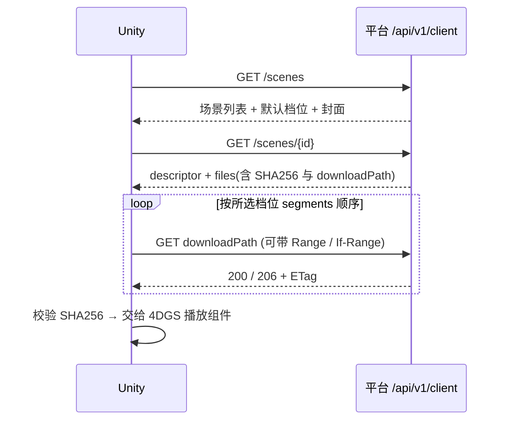

# Unity 对接技术文档

## 0. 给 Unity 同事的上手说明（先读这一节）

### 0.1 我们提供了什么

平台是一台服务器，里面存着做好的 4DGS 场景（动态高斯重建的三维成品）。你的 Unity 程序只需要做三件事，都是普通的 HTTPS 请求，不用登录：

1. 问服务器“有哪些场景”，拿到名字、封面、可选画质档位。
2. 选一个场景，问服务器“这个场景有哪些文件”，拿到每个文件的下载地址、大小和校验码（SHA256）。
3. 按地址把文件下载到手机或电脑本地，校验码对得上就交给你们的 4DGS 播放组件。

接口有三个，都只读：场景列表、场景详情、文件下载。文件很大（一个标准档约 69 MB），所以下载支持“断了接着下”（HTTP Range）。服务器不负责播放、不判断设备性能、不改模型坐标，这些由 Unity 侧决定。

“接口”可以理解为：你访问一个网址，服务器返回一段 JSON 文字或一个文件。先用浏览器或命令行试一次，就能看出它长什么样：

```bash
BASE=https://4dgs.elma-gohan.xyz
curl -s "$BASE/api/v1/client/scenes"   # 能看到 JSON 说明通了
```

### 0.2 给 AI agent 的提示词

把下面整段贴给 agent，并让它能读到本仓库的 `docs/21-client-api.md` 和 `docs/22-unity-integration.md`：

```text
你在 Unity 项目里实现 4DGS 场景下载与加载。请先完整阅读 docs/21-client-api.md 和 docs/22-unity-integration.md，严格以这两份文档为准，不要凭经验猜接口。

要做的事：
1. 写 PlatformConfig（BaseUrl 可配置）和第 4 节的数据结构，用 Newtonsoft.Json 解析。
2. 实现：获取场景列表、获取场景详情、按所选档位（variant）列出需要下载的文件（第 5 节）。
3. 实现下载器（第 6 节）：用 DownloadHandlerFile 写 .part 文件，保存 ETag，用 Range 和 If-Range 断点续传，处理 200/206/416/409，下载完流式校验 SHA256，全部完成后写 ready 标记。
4. 下载完成后把目录路径交给播放组件；播放组件的接入点先留接口，不要自己实现渲染。

约束：
- 不要把整个文件读进内存；不要对列表接口轮询；不要二次编码 downloadPath；找不到所选档位就报错，不要换档位。
- 按 HTTP 状态码处理错误，不解析 message。
- 文档里标“待验证”的内容（坐标系、音画同步、流式输入、webm 播放）不要当成已确认，写代码时留开关或注释，并在最后列出来。
- 完成后告诉我：改了哪些文件、实际运行过什么、哪些没验证。可以参考 scripts/download_scene.py 的目录布局和退出码，但它是 Python 联调参考，不是要移植的 SDK。
```

### 0.3 怎么操作平台（管理端）

Unity 侧读到的场景，都是管理员先在后台上传并发布的。要自己放测试内容，按下面做：

1. 打开管理后台：`https://4dgs.elma-gohan.xyz`（和客户端接口同一个地址）。账号和密码向管理员要，不要写进文档或聊天。
2. 登录后进入场景列表，没有场景就先新建一个；每行有“版本与文件”，点进去。
3. 准备一个资源目录：根目录下必须有一个 `resource.json`（描述档位、分段文件、变换、封面、音频等，格式见[示例](../contracts/examples/resource-descriptor.json)），它引用的所有模型和附件放在同一目录下。
4. 点“导入资源目录”，选这个目录。页面会读取 `resource.json`，显示档位、段数和总大小，然后在浏览器里计算每个文件的校验码，创建版本，再逐个上传。上传中断了，重新选同一目录点“继续上传”，已上传的不会重传。
5. 全部文件显示可用后，把这个版本“发布”。每个场景同一时刻只有一个发布版本，客户端只能读到它。
6. 回到 Unity 或用 `curl $BASE/api/v1/client/scenes` 检查，应该能看到这个场景。

注意：版本创建后内容不可修改，要改模型或配置就新建版本再发布；发布新版本后，客户端正在下载旧版本会收到 409，按第 6 节处理即可。删除版本是整版物理删除，不可恢复。

---

## 1. 平台提供什么，不提供什么

提供：场景目录、场景描述（档位、分段时间、变换、配置/封面/音频/预览文件）、文件的 HTTP Range 下载、强 ETag、SHA256 清单。

## 2. 总体流程



## 3. 配置项

```csharp
public static class PlatformConfig {
    public const string BaseUrl = "https://4dgs.elma-gohan.xyz"; // 开发机经反向隧道对外提供；开发机离线时不可用
}
```

- 当前是 HTTPS（Let's Encrypt 证书），Android 和 iOS 都不需要放行明文流量。若以后改回内网明文地址，Android 需在 manifest 允许明文流量（`usesCleartextTraffic`），iOS 需配置 ATS 例外。
- `downloadPath` 与 `posterUrl` 是以 `/` 开头的相对路径，用 `new Uri(new Uri(BaseUrl), path)` 拼绝对地址。路径里已含 URI 编码，不要二次编码。

## 4. 数据结构（C#）

字段名用 camelCase，与 JSON 对应。Unity 自带 `JsonUtility` 不支持顶层数组和可选字段，建议用 Newtonsoft.Json（`com.unity.nuget.newtonsoft-json`）。不要用位置式 `record`：Unity 2022.3 支持 C# 9，但默认运行库没有 `System.Runtime.CompilerServices.IsExternalInit`，这些声明编不过。

```csharp
public class SceneList {
    public List<SceneItem> items;
    public int total;
}
public class SceneItem {
    public string id, name, versionId, defaultVariant;
    public int versionNo;
    public List<VariantInfo> variants;
    public string posterUrl; // 可能为 null
}
public class VariantInfo {
    public string id, name;
    public int segmentCount;
    public double durationSeconds;
}
public class SceneDetail {
    public string sceneId, name, versionId;
    public int versionNo, fileCount;
    public long totalBytes;
    public Descriptor descriptor;
    public List<FileEntry> files;
}
public class FileEntry {
    public string fileId, relativePath, sha256, contentType, downloadPath;
    public long bytes;
}
public class Descriptor {
    public int formatVersion;
    public string defaultVariant, settings, poster, audio, preview;
    public double[] audioPosition; // 可能为 null
    public Transform transform;
    public List<Variant> variants;
}
public class Transform {
    public double[] position, rotation, scale; // rotation 单位：度
}
public class Variant {
    public string id, name, format;
    public List<Segment> segments;
}
public class Segment {
    public string path;
    public double startSeconds, durationSeconds;
}
```

## 5. 选档位与取文件

```csharp
IEnumerable<FileEntry> FilesFor(SceneDetail d, string variantId) {
    var v = d.descriptor.variants.First(x => x.id == variantId);   // 找不到就报错，不要换档位
    var byPath = d.files.ToDictionary(f => f.relativePath);
    foreach (var s in v.segments) yield return byPath[s.path];       // 按数组顺序
    foreach (var p in new[] { d.descriptor.settings, d.descriptor.poster,
                              d.descriptor.audio, d.descriptor.preview })
        if (p != null) yield return byPath[p];
}
```

默认档位用 `defaultVariant`；手机与 VR 对应哪个档位由你们产品决定，平台不做设备判断。

## 6. 下载与断点续传

不要用一次性 `UnityWebRequest.Get` 把几十到几百 MB 读进内存。用 `DownloadHandlerFile` 直接写文件（`appendToFile` 可续写），再用 `ComputeHash` 流式校验。要点：

1. 目标文件 `<name>.part` 与 `<name>.etag` 放在 `Application.persistentDataPath/<sceneId>/<versionId>/<variantId>/` 下。
2. 首次：普通 GET，保存响应头 `ETag`。
3. 续传：`SetRequestHeader("Range", $"bytes={partLength}-")` 和 `If-Range: <保存的 ETag>`。
   - 返回 `206`：检查 `Content-Range` 起点等于 `partLength`，追加写入。
   - 返回 `200`：服务器忽略了 Range 或版本内容变了，**清空 .part 从头写**。
   - 返回 `416`：.part 异常，删除重下。
4. 下完比对 SHA256 与 `FileEntry.sha256`，一致才重命名为正式文件；不一致删除 `.part` 和 `.etag` 后重下该文件。
5. 全部文件完成后再写 `ready` 标记（同目录原子写），Unity 只加载有 `ready` 标记的目录。
6. 409：当前版本已被替换。停止，保留旧目录（可继续使用），重新拉详情走新 `versionId` 目录；不要混用。

`DownloadHandlerFile` 的 `removeFileOnAbort` 在续传场景要设为 `false`。

参考实现在 `scripts/download_scene.py`，目录布局、状态文件和退出码语义可以直接对照（Python，仅作联调参考，不是 SDK）。

## 7. 在线分段加载（边下边播）

- 描述里的 `segments` 给出每段文件和起止时间。播放时按 `startSeconds` 顺序预取下一段，当前段播放到 `startSeconds + durationSeconds` 前就应已就绪。
- 每段文件走第 6 节同样的流程，可以只读到本地缓存再交给播放组件，也可以用 Range 分块边读边解码——这取决于你们的 4DGS 组件是否支持流式输入，**待验证**。
- 段内时间与模型内部时间的换算由播放组件负责，平台不改写模型。参考播放器（4DV 的 PlayCanvas viewer）已验证：按 `segments` 顺序加载后，跨段（wedding 5 秒、dance_color 的 5 秒分段）时间连续推进。

## 8. 变换、音频、封面

- `transform.rotation` 是**度**，`position` 与 `scale` 为 3 元数组；先应用到场景根节点，再叠加你们的 AR 锚点。Unity 与参考播放器的坐标系（手系、Y 轴方向）不一定一致，**待验证**，平台不做转换。
- `settings` 是播放器相机/动画配置 JSON（`xrCamera`、`camera`、`animTracks` 等，`animTracks.duration` 是相机轨道时长，不等于模型总时长），是否使用由你们的播放组件决定。
- `audio` 与 `audioPosition` 用于空间音频；参考验证里无头 Chrome 的音频没有启动，音画同步**未验证**。
- `poster` 用于列表封面，`preview` 是可选预览视频（webm）。Unity 对 webm 的支持因平台而异，必要时只用封面。

## 9. 错误与重试

- 按 HTTP 状态码处理，不解析 `message`（见 21 号文档第 6 节表格）。
- 超时、断网：保留 `.part` 和 `ETag`，指数退避后续传，不要自动拉全量文件列表。
- 平台没有限流，但也不要对列表接口做秒级轮询；场景列表只在进入页面时刷新。

## 10. 联调清单

1. 手机浏览器能打开 `https://4dgs.elma-gohan.xyz/api/v1/client/scenes`，返回场景列表 JSON；打不开先确认开发机在线、反向隧道在运行。
2. `GET /scenes` 能返回至少一个场景；用 `curl` 先对照 21 号文档第 8 节。
3. 下载 dance_color 标准档（`standard_quality`，约 337 MB，15 段加公共文件），SHA256 全部通过。当前服务上只有这个示例场景。
4. 手动断网后续传：`.part` 后继续，最终 SHA256 一致。
5. 管理端发布新版本后，旧 `versionId` 的下一个请求应得到 409，客户端按第 6 节处理。
6. 在 Unity 中加载并显示首帧；记录 GPU/内存占用（样例参数分析见项目外的《4DGS模型高斯参数与内存显存规格分析报告》）。
7. 手机真机：LAN 访问、下载速度、解码、渲染帧率、音画同步。

## 11. 本轮已验证与未验证

| 项 | 状态 |
|---|---|
| 匿名目录/详情/文件、Range、If-Range、HEAD | 隔离实例上已验证 |
| Python 参考下载器：断点续传、版本变化 409、损坏文件重下 | 已验证 |
| 桌面 Chrome 参考播放器：wedding 标准/高清、dance_color 标准跨段 | 已验证（RTX 4060） |
| Unity 编辑器/手机下载与加载 | **未验证** |
| 手机端解码、帧率、音频、坐标系对齐 | **未验证** |
| HTTPS | 已启用（Let's Encrypt，经 elma-gohan 反代） |
| CDN、长缓存 | 未实现 |
