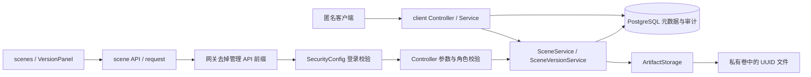
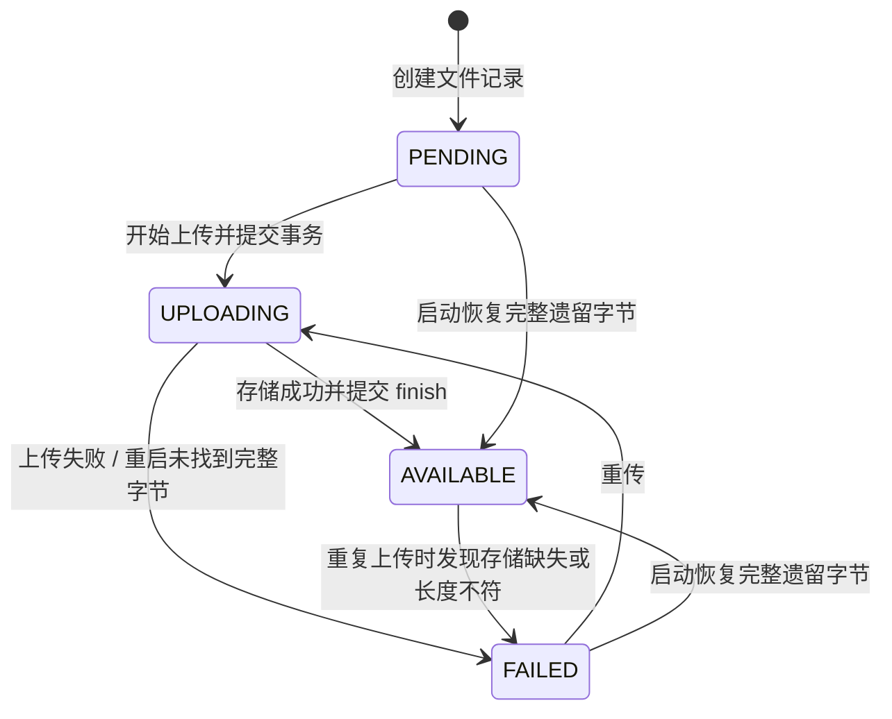

# 业务代码阅读与人工 Review 导读

整理日期：2026-11-04。源码基线：`eea5266`（Knife4j 部署版本）。注释导读已于 `659b9a8` 提交；2026-11-04 在 `refactor/ar-package-layers` 按职责分包，本文链接同步指向新位置。这里记录源码中的执行顺序，供人工核对，不代表独立审查已通过。

## 从哪里开始读

先顺着一次正常导入读完，再回看失败和恢复。下表链接均指向当前仓库源码；方法名用于编辑器内定位。

| 顺序 | 入口 | 阅读重点 |
|---|---|---|
| 1 | [scenes.vue](../frontend/src/views/demo/scenes.vue)：save / openVersions | 场景名称、按账号保存的新建草稿、URL 场景选择、乐观锁 |
| 2 | [VersionPanel.vue](../frontend/src/views/demo/VersionPanel.vue)：picked → startImport → runSession | 整条导入链路的页面编排，自动发布也在这里 |
| 3 | [scenePackage.js](../frontend/src/utils/scenePackage.js)、[hash.worker.js](../frontend/src/views/demo/hash.worker.js) | 路径/清单预检、摘要、续传检查、三路派发 |
| 4 | [scene.js](../frontend/src/api/scene.js)、[request.js](../frontend/src/utils/request.js) | HTTP 路径、原始字节上传、Bearer Token、响应处理 |
| 5 | [SceneController](../backend/ruoyi-ar/src/main/java/com/ruoyi/ar/controller/SceneController.java)、[SceneVersionController](../backend/ruoyi-ar/src/main/java/com/ruoyi/ar/controller/SceneVersionController.java) | HTTP 参数校验、角色要求与状态码；不在控制器编排文件状态 |
| 6 | [SceneService](../backend/ruoyi-ar/src/main/java/com/ruoyi/ar/service/SceneService.java)、[SceneMapper](../backend/ruoyi-ar/src/main/java/com/ruoyi/ar/mapper/SceneMapper.java) | 场景写入与审计的事务，场景软删除 |
| 7 | [SceneVersionService](../backend/ruoyi-ar/src/main/java/com/ruoyi/ar/service/SceneVersionService.java)：create → upload → finish → publish | 清单固定、数据库事务与存储提交分段、发布指针 |
| 8 | [LocalArtifactStorage](../backend/ruoyi-ar/src/main/java/com/ruoyi/ar/storage/LocalArtifactStorage.java) | 文件锁、大小/SHA256 校验、暂存与正式文件 |
| 9 | [ClientSceneController](../backend/ruoyi-ar/src/main/java/com/ruoyi/ar/controller/ClientSceneController.java)、[ClientSceneService](../backend/ruoyi-ar/src/main/java/com/ruoyi/ar/service/ClientSceneService.java)、[HttpRange](../backend/ruoyi-ar/src/main/java/com/ruoyi/ar/support/HttpRange.java) | 匿名可见条件、下载前复核、Range 响应 |
| 10 | SceneVersionService：removeVersion → completeDeletion → afterPropertiesSet | 删除意图、部分失败、启动续做与文件对账 |

目录与依赖边界见 [ruoyi-ar 模块说明](../backend/ruoyi-ar/README.md)。请求 DTO 已独立到 dto 包；场景和审计列表由 Controller 调用 SceneService，再访问 SceneMapper。

## 请求如何穿过系统

开发环境 API 前缀为 `/dev-api`，由 Vite 代理去掉；生产管理 API 前缀为 `/prod-api`，由 nginx 去掉。匿名 `/api/v1/client/` 保持原路径代理。路径规则见 [nginx.conf](../deploy/nginx.conf) 与 [vite.config.js](../frontend/vite.config.js)。

[SecurityConfig](../backend/ruoyi-framework/src/main/java/com/ruoyi/framework/config/SecurityConfig.java) 只放行列出的路由；管理场景路由要求登录，版本控制器另有 `ar_admin` 角色检查。Knife4j 页面与 JSON 可匿名读，这不授予业务写权限。[ArExceptionHandler](../backend/ruoyi-ar/src/main/java/com/ruoyi/ar/exception/ArExceptionHandler.java) 处理 AR 控制器异常；过滤器阶段的未登录拒绝和框架登录接口不走同一响应出口。

## 数据分别保存什么

| 对象 | 用途 | 审查时核对 |
|---|---|---|
| ar_scene | 场景名称、启停、软删除、场景 lock_version、唯一发布指针 | 更新是否匹配场景修订号；软删除不清理文件 |
| ar_scene_version | 固定清单所属版本、说明、版本 lock_version、request_key | 说明可改；版本修订号与场景修订号独立 |
| ar_version_file | 路径、预期大小/摘要、上传状态、校验值和操作者 | AVAILABLE 必须具有与预期一致的校验记录 |
| ar_version_deletion | 删除意图、失败原因、完成时间、幂等键回执 | 不依赖被删版本行继续存在，已删除请求键不能被复用 |
| ar_audit | 谁执行了什么操作 | 业务更新与对应审计是否在同一事务 |
| 私有存储卷 | 实际内容，使用文件 UUID 定位 | relativePath 不作为服务器落盘路径 |

实际迁移随应用打包；结合 [V015](../backend/ruoyi-admin/src/main/resources/db/demo/V015__scene_product_versions.sql) 和 [V017](../backend/ruoyi-admin/src/main/resources/db/demo/V017__remove_version_descriptor.sql) 读最终表结构。V015 中创建的 descriptor 已被 V017 删除，根目录 database/migrations 是历史候选。阅读迁移不需要在日常库执行它们。

## 正常导入：先登记，再逐文件入库，最后发布

1. `picked` 调用 `readPackage`，目录选择去掉顶层目录名，多文件选择保留文件名；检查路径冲突、空文件和配置上限。ZIP 作为原始文件，不解包。
2. `startImport` 建立本页 `session` 并生成 requestKey。`hashAll` 对每文件启动 Worker，每次读 2 MiB，按整个目录累计字节显示预计算进度。
3. `createRequest` 只发送说明和文件路径/大小/SHA256；`create` 先做参数检查，再在事务里锁场景行，检查删除回执和 requestKey，分配版本号并写版本、文件行与审计。
4. 同场景、同 requestKey 的说明和规范化文件集合相同，返回已有版本（200）；内容不同返回 409；请求键有删除回执返回 410。首次创建返回 201，此时文件默认 PENDING，还没有正文入库。
5. 页面重新读取版本，`uploadPlan` 跳过 AVAILABLE，不重发 UPLOADING，只派发 PENDING/FAILED。每页最多三路，各网页独立，没有全站总并发上限。
6. 每个文件 PUT 以 `application/octet-stream` 发送原始正文。服务端取得版本读锁，登记 activeUploads，再依次执行下面三段。

| 阶段 | 数据库 | 文件系统 | 失败/中断后如何继续 |
|---|---|---|---|
| 事务 1 | 非 AVAILABLE 文件置 UPLOADING，清空旧校验值，attempts 加一，记开始审计 | 尚未写正文 | 事务回滚不进入 IO；提交后中断则由对账或后续重传处理 |
| 事务外 IO | 不持有上传数据库事务 | .part 接收并校验 → 原子改名 .ready → 硬链接 .bin → 删 .ready | IO 错误后 finish 记 FAILED；进程中断则可能留下暂存或正式内容 |
| 事务 2：finish | 成功 AVAILABLE，失败 FAILED；校验值与审计一起提交 | 不再重新写正文 | 文件已落盘但事务未完成时，启动恢复可核对完整遗留字节并补记 |

`LocalArtifactStorage.publish` 仅把文件提交到正式存储；业务发布由 `SceneVersionService.publish` 完成。AVAILABLE 重复上传只核对正式文件大小，不消费新正文、不重新算摘要；核对失败会记为 FAILED。非 AVAILABLE 的遗留内容校验失败时，业务层才会删残留并重新接收。

## 续传、取消和自动发布

`session` 中的 File 对象、摘要、requestKey 和 versionId 只在当前页面内保留。创建响应丢失时，同 session 再请求会复用 requestKey；刷新页面后需重新选原目录/文件。续传先比较路径和大小，再比较摘要，不能替换固定清单中的内容。

`runUploads` 中一个文件失败不终止其他文件。`uploadOne` 对无响应、502/504 等结果不确定的情况调用 `reconcile` 查单文件；明确业务错误交给本轮汇总。页面只把实际返回的文件记录写回表格；“请求失败”和“结果未确认”分开显示。

`cancel` 终止本地哈希、取消在途请求并停止后续派发。服务端可能已经完成入库，因此取消不回滚版本、不把文件直接判成 FAILED。切换场景时请求序号/runToken 防止旧回调覆盖新页面，但不能撤销服务端已经完成的写入。

本轮所有任务结束后，页面再 GET 全版本，确认 READY 且文件全为 AVAILABLE，才独立调用发布接口。发布使用上传开始时记下的 `sceneLockVersion`；期间场景被修改会返回 409。自动发布失败时，已入库文件保留，页面提示人工核对后手动发布。

`publish` 持目标版本写锁，在事务中锁场景行，核对场景修订号和文件聚合状态，切换 published_version_id、递增场景修订号并写审计。已经是当前发布版本则幂等返回；不重新搬文件，也不重新读正文或计算摘要。原发布版本仍在后台，匿名客户端后续只读取新的当前版本。

## 状态怎么读

以上是文件状态。版本 uploadStatus 由 `SUMMARY` 查询临时聚合：先看未完成删除回执（DELETING/DELETE_FAILED），再看 UPLOADING、FAILED、全部 AVAILABLE 时 READY，否则 PENDING。版本是否发布由场景指针决定，与 READY 独立。页面传输进度是字节发送进度，不能替代服务端文件状态。

## 匿名读取与下载

`ClientSceneService.VISIBLE` 要求场景启用且未软删除、有发布指针、版本内没有非 AVAILABLE 文件、没有未完成删除。列表/详情只查数据库，详情按路径返回文件清单与下载 URL，不打开模型正文。

`clientDownload` 在读锁前后检查场景与版本关系，并检查文件归属、URL 文件名、删除状态和文件就绪状态。旧版本不再是当前发布版本时返回 409，客户端需重新取详情；不会把旧 URL 改指向新版本字节。已开始传输的请求不持续检查场景指针，读锁保护的是 URL 对应版本的文件。

`stream` 核对实际长度，登记 SHA256 用作 ETag；不在下载时重算摘要。`HttpRange` 支持单区间，合法不可满足返回 416，非法格式/多区间/If-Range 不匹配按完整 200 响应。HEAD 只写响应头；GET 以区间偏移和长度打开正文并分块输出。此路径不解析 4DGS 内容，也不证明 Unity 或手机播放可用。

## 删除与启动恢复

场景 `delete` 只更新 deleted_at/enabled 和审计；不会调用存储清理。整版物理删除走版本的 `removeVersion`，当前发布版本返回 409，需先发布其他版本。

整版删除持版本写锁。事务 A 锁场景行、登记/更新删除回执并写请求审计；事务提交后 `completeDeletion` 在事务外逐文件删除 .part/.ready/.bin。全部成功才在事务 B 删文件行、版本行、标记回执完成并写完成审计。审计与最小回执保留。

部分文件已删后失败，不恢复这些文件；记录失败原因、保留版本和文件行供重试。删除全部字节后数据库事务失败，也可以按原 UUID 再删并完成提交。已完成回执让重复 DELETE 成功，未知版本且无回执返回 404。

`afterPropertiesSet` 在数据库初始化后执行：先续做未完成删除，再盘点存储，按 UUID 游标每批查 100 条 PENDING/UPLOADING/FAILED。有完整 .bin/.ready 且校验通过才补为 AVAILABLE；只有 .part 不算完成，仍 UPLOADING 的记为 FAILED。盘点失败拒绝启动；单版本删除失败会记录并留待后续重试。AVAILABLE 不在此对账查询中，因此重启不是全量完整性扫描。

## 人工 Review 时重点核对

| 问题 | 代码位置 |
|---|---|
| 场景修订号与版本修订号是否传对？409 后页面如何刷新？ | saveDescription / publish / runSession、SceneService、版本 edit/publish |
| 创建响应丢失后会不会重复建版本？刷新网页后如何继续？ | startImport、create、sameRequest、删除回执查询 |
| 文件何时正式可读，何时数据库才记为 AVAILABLE？ | uploadLocked、finish、store、publish、recoverLocked |
| 取消、网关超时和服务端失败是否区分？ | cancel、uploadOne、reconcile、uploadIssues |
| 读写锁覆盖到哪里，数据库行锁又覆盖到哪里？ | lockRead/lockWrite、upload、publish、removeVersion、clientDownload |
| 部分删除后怎么继续，是否还会对外下载？ | completeDeletion、PENDING_DELETION、VISIBLE |
| 发布切换时下载 URL 是否仍对应同一版本？ | clientVersion、clientDownload、客户端详情 downloadPath |
| 哪些异常返回业务错误，哪些在过滤器处理？ | ArExceptionHandler、SecurityConfig |

这些问题是阅读检查点，不是已确认缺陷。锁规则按单应用实例理解；版本锁表按需增长、不回收。当前任务没有修改这些实现，也没有对全部并发路径作独立审查结论。

## 本轮验证

验证命令、结果和限制记录在 [验证记录](06-validation.md) 的“2026-11-04 业务注释与人工 Review 导读”。本次分包仅在本地隔离实例验证，未部署云端；注释阶段与分包阶段的证据分别记录。
