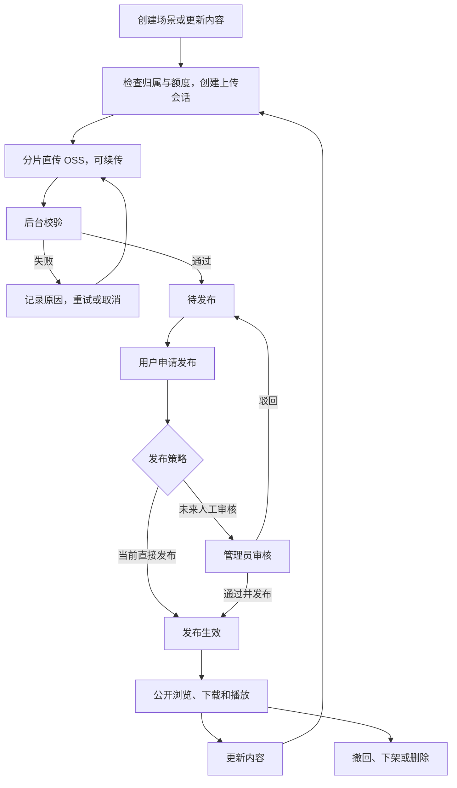

# 4DGS 产物平台：当前简化方案与架构调研

记录日期：2026-11-05；更新：2026-11-06。状态：用户已批准管理员单场景模型实施，本地业务与资源分发已验证，待用户界面确认；日常服务未升级，未执行生产迁移或部署。实际证据见[验证记录](06-validation.md)。

**当前优先级以第 0 节为准。** 第 1–10 节保留 2026-11-05 的长期需求与架构调研，其中“主动发布”“当前内容加待发布内容”“普通用户及云基础设施同时建设”等建议不作为本次实施范围。现行实现仍见 [资源入库闭环](12-resource-ingestion.md)、[当前架构](11-current-platform-architecture.md) 和 [客户端接口](21-client-api.md)。

## 0. 当前实施方案：管理员单场景单模型（2026-11-06）

### 已确认需求与取舍

用户要求先完成“产物上传到已有播放器”的链路：目前只有管理员账号；上传即发布；提供启用/停用；将场景信息与文件管理合并；一个模型不对应多个版本。

针对“模型上传成功后如何更换文件”，用户明确选择 **“新模型新建场景”**：已完成模型的文件清单和内容固定，原场景可改名称、说明、启停或删除；换模型使用新的场景 ID。上传未完成时可继续传原文件，不视为创建新模型。

用户已发出实施指令并允许使用 DeepSeek 子代理。随后进一步确认：“只需要提供资源分发就行了，客户端可以完成解压与解码，已经跑通了。”因此本轮不修改播放器，验收后端资源清单、文件字节和续传等分发行为。

### 页面与业务流程

- 场景列表展示名称、业务状态、文件数量、总大小、更新时间；操作为查看/编辑、启用/停用和删除。
- 新建与详情统一承载名称、说明、目录/多文件选择、上传进度和文件列表，沿用现有管理后台风格；删除独立“版本与文件”入口及其版本列表、发布卡片、手动发布和替换发布按钮。
- 新建时填写名称、说明并选择文件，开始上传后登记固定清单；全部文件经服务端校验完成即对客户端可用，不增加一次人工发布操作。
- 上传失败或中断显示原因，可重新选择原文件继续；已确认完成的文件跳过。沿用当前逐文件恢复，不把它描述为已有分片续传。
- 列表可显示“待上传/上传中/上传失败/已启用/已停用/删除中/删除失败”。上传进度与可访问状态有区别，发送字节达到 100% 不代表全部文件已确认可用。

### 最小后端模型与访问规则

业务数据关系收敛为 **场景 → 文件**。场景保存名称、说明、启停状态和时间等信息；文件直接关联场景，保存相对路径、大小、摘要、存储标识和上传状态。去掉业务版本表、版本号、发布指针和独立发布流程；内部并发修订号继续用于防止操作覆盖，但从页面隐藏。

客户端访问条件为：场景启用、未删除/未进入删除、文件清单非空且全部可用。首次创建默认启用，完成校验后自然满足可见条件，实现服务端“上传即发布”；无需浏览器再调用发布接口。管理员主动停用后，上传完成或恢复处理不得自动将其重新启用。

启用/停用沿用现有业务入口与审计。停用后，新的客户端列表、详情和文件读取均拒绝访问该场景，管理员仍可查看；已开始传输的文件允许读完，本地已下载内容无法撤回。

删除场景统一清理所属模型文件，不再让管理员先删除版本再删除场景。复用当前删除意图、失败续做和审计能力，迁移到场景级；清理失败保持不可公开，并显示可重试状态。

### 实施顺序与影响范围

| 顺序 | 改动 | 验收结果 |
|---|---|---|
| 1. 数据与接口 | 将说明、文件关联、删除恢复归到场景；去掉版本 CRUD 和发布 API；保留请求幂等、摘要和并发控制 | 一个场景只有一套文件，上传重试不生成额外场景，完成后文件不可替换 |
| 2. 管理页面 | 合并场景信息、文件与上传编排，删除旧版本面板 | 管理员在一个详情页面完成创建、上传、编辑信息和文件查看，无版本选择及发布动作 |
| 3. 客户端与工具 | 场景详情直接返回文件清单，文件 URL 和下载状态移除业务 `versionId/versionNo`；同步上传/下载工具、生成契约和文档 | 既有 Range/If-Range/SHA256 行为保留，已知调用方同步切换，无废弃接口兼容壳 |
| 4. 分发链路回归 | 核验上传、固定清单、下载、续传、启停和删除 | 上传完成立即可读；停用拒绝新请求；启用恢复；删除清理文件 |

当前入口：[场景页面](../frontend/src/views/demo/scenes.vue)、[前端 API](../frontend/src/api/scene.js)、[场景服务](../backend/ruoyi-ar/src/main/java/com/ruoyi/ar/module/scene/service/SceneService.java)、[文件服务](../backend/ruoyi-ar/src/main/java/com/ruoyi/ar/module/scene/service/SceneFileService.java)。启停沿用已有入口；旧网页完成上传后的额外发布调用移除，服务端按文件就绪状态提供访问。

### 数据迁移与验证边界

- 迁移前输出当前场景、版本和文件映射清单并备份。推荐原来对客户端可见的模型保留场景 ID 和启停语义；历史或未发布资源迁为独立停用场景，避免丢文件或意外公开。具体映射须根据实际数据确认，未授权执行迁移或删除历史文件。
- 客户端契约发生不兼容变更，仓库工具同步切换为场景/文件身份；本轮提供准确的分发文档和接口。客户端解包、解码按用户已跑通的事实沿用，不改播放器，不把联调其他仓库作为本轮前置。
- 必测正常上传、部分失败续传、关闭页面后服务端状态、重复完成/请求、启停后的列表与文件访问、删除失败续做、重启恢复，以及非空旧库迁移后的归属和可见性。数据库迁移和数据约束使用隔离 PostgreSQL 验证。
- Java 改动执行受影响模块测试；前端检查并实际登录、上传、启停、删除。文件字节、摘要、Range 和续传是本次验收范围；合成字节不证明渲染，也不据此否定用户已跑通的客户端。
- 原工作区未提交改动保留，实施在独立 worktree 和 `feat/admin-scene-files` 分支，源码与证据不覆盖原工作区。

**本次范围建议：先收敛管理员业务与播放器接口，保留当前存储链路；OSS/CDN 迁移另立实施阶段。** 暂不新增普通用户、人工审核、消息队列、独立 Worker、社交或 GPU 调度。此阶段验收不构成千人播放能力证明。

---

## 1. 用户已确认的需求

- 主要业务是 **4DGS 场景采集和训练**。平台需要提供产物上传接口，供采集端、训练程序及用户客户端接入，并管理产物的存储、发布、下载和播放访问。
- **已有 4DGS 播放器。** 后端应对接已有播放器，不将重新开发播放器列为默认任务。本轮未核对该播放器的仓库、格式、分段能力、首帧依赖、终端适配或实际性能。
- 预计同时在线和播放人数为 **上千人**。这是业务规模预期，不是已测容量；上传峰值、产物大小分布、播放数据率和地域分布尚未确认。
- 用户侧需要上传、下载、播放、删除，以及提交发布/审核的能力；资源归属、数据隔离和用户数据治理由后端负责。
- **现阶段可以用户直接发布；后续由管理员审核并发布。** 需要梳理完整业务流程，而非只提供文件存储。
- 用户质疑同一场景下多版本管理的必要性，需要简化评估；尚未确认删除历史版本能力或限制为单份待发布内容。
- 后续可能加入评论、点赞，以及云端 GPU 算力和训练任务调度。当前只考虑接入边界，暂不实现这些业务。

“已有播放器”与仓库旧参考播放器失效是两件事：仓库旧参考播放器的历史边界仍成立，不能据此推断用户没有播放器，也不能把用户的播放器当作已经通过本平台联调。

## 2. 当前实现及瓶颈

| 已核对的现状 | 对后续设计的影响 |
|---|---|
| 管理端按场景创建固定文件清单的版本，只有一个当前发布指针；账号当前为管理员角色 | 普通用户、资源所有权、用户配额和审核需要新增业务规则 |
| 列表、详情只查元数据；文件由 Nginx 转给 Java，Java 同步读取本地文件并写出 | 文件占用业务请求处理资源，并共享单机磁盘和网络出口 |
| 仓库配置为 Tomcat 最大线程数 800、accept-count 1000 | 配置值不能换算为流畅播放人数，运行环境是否覆盖也未检查 |
| 文件响应为 `no-store, no-transform`，支持单段 Range、If-Range 和强 ETag | 续传基础可复用；CDN 缓存、授权和文件响应规则需重新设计 |
| 文件上传是整个文件流经过 Java；失败后按文件重传，没有上传分片会话 | OSS 分片直传需要新的上传流程，不能仅替换存储 SDK |
| Redis 已用于登录状态 | 不是“新引入 Redis”；需要评估新增缓存、限流用途及容量 |
| `VersionConcurrency` 使用进程内锁和活动上传集合 | 多实例时需要数据库原子状态约束和共享任务协调 |
| 新版发布后，旧版后续文件请求返回 409；已开始的流可以读完 | 连续播放与长下载需要明确旧内容访问窗口 |
| 当前文档记录：管理页面上传就绪后自动调用发布接口；后端上传、发布 API 分离 | 用户主动发布及后续审核需要调整前端流程；现状不是服务端自动发布 |
| 场景逻辑删除不递归清理模型，整版删除有独立意图与恢复流程 | 用户侧“删除作品”需要统一编排文件、上传会话、任务和缓存清理 |

2026-11-05 依据中的旧版本文件服务及并发管理器已经在本次切换中迁入[场景文件服务](../backend/ruoyi-ar/src/main/java/com/ruoyi/ar/module/scene/service/SceneFileService.java)和[场景并发管理](../backend/ruoyi-ar/src/main/java/com/ruoyi/ar/module/scene/manager/SceneConcurrency.java)。共享[存储接口](../backend/ruoyi-ar/src/main/java/com/ruoyi/ar/storage/ArtifactStorage.java)、[HTTP Range](../backend/ruoyi-ar/src/main/java/com/ruoyi/ar/support/HttpRange.java)、[网关](../deploy/nginx.conf)、[配置](../backend/ruoyi-admin/src/main/resources/application.yml)和[登录服务](../backend/ruoyi-framework/src/main/java/com/ruoyi/framework/web/service/TokenService.java)继续沿用对应职责；本节表格是旧基线观察，不是当前多版本功能声明。

**核心发现：把 Java 拆成多个服务但仍共享同一台服务器出口，无法解除文件传输的带宽瓶颈。首先应让大文件流量绕过业务 API。**

## 3. 推荐的场景模型：简化业务版本管理

建议面向用户展示“我的场景 → 上传/更新 → 发布 → 管理”，不要求用户操作版本号和发布指针。一个场景是一件独立作品；另一次独立采集形成的新作品创建新场景，修正同一作品的内容走更新。

候选模型：**一个稳定场景 + 一份当前发布内容 + 最多一份待发布内容**。

- 场景保存稳定 ID、作者、名称、介绍和治理状态。
- 每批上传文件有独立内容 ID，清单和文件固定；一次文件集合不要求打包为 ZIP。
- 新内容上传、校验、未来审核期间，当前发布内容继续服务；发布时切换引用。
- 普通替换后的旧文件在约定窗口内供已有访问继续使用，随后自动清理；保存操作记录，不默认永久保存所有旧模型。
- 文字修改不复制模型文件；未来需要审核的文字与文件集合一起形成确定的送审内容。
- 客户端用固定内容 ID 识别缓存和续传对象，未来审核也绑定具体内容，避免内容在审核后被替换。

建议取消面向用户的历史版本列表和任意回滚，而不是直接把数据库中的文件集合层删除。现有固定清单和原子发布能力仍有价值。**单份待发布限制、历史文件清理、回滚取舍和保留时长均待用户确认，不执行现有数据清理。**

## 4. 业务生命周期

发布建议由用户主动触发，上传完成只进入待发布；这是对现有页面自动发布的建议变更。直接发布记录真实操作来源，未来人工审核记录审核人、结果和原因。文件处理状态、审核状态、发布状态分别表达，避免一个状态字段混合三种含义。

| 操作 | 推荐规则 |
|---|---|
| 上传 | 按身份检查归属和限制，预留容量，登记文件和上传会话；文件直达 OSS |
| 完成上传 | 核对对象并进入后台校验，客户端成功回调本身不代表资源可用 |
| 校验 | 核对大小和摘要；完整性通过不等于模型能被播放器解码，格式验证须与已有播放器契约对接 |
| 发布 | 文件全部就绪、发布策略允许、账号及场景未被限制后，原子更新当前公开内容 |
| 更新 | 新文件集合独立准备；已有下载/播放锁定原内容，在约定窗口内完成 |
| 用户撤回 | 停止公开展示和新公共访问授权，保留私有文件；所有者可继续管理 |
| 管理员下架 | 记录原因，阻止用户通过再次发布绕过治理决定；恢复须经平台规则处理 |
| 取消更新 | 清理待发布内容及上传会话，不影响现有发布内容 |
| 删除场景 | 先隐藏并禁止新操作，后台清理对象、未完成分片和相关任务；完成后标记删除完成 |

上传和删除之间需要数据库状态约束：删除开始后，迟到的上传完成通知不得使资源重新可用。任务重复执行应安全，任务进度和失败原因可查询。

## 5. 隔离、授权与数据治理

- 每个场景具有明确所有者；文件、上传会话、后台任务都能追溯到所属场景和用户。当前先解决个人归属，不因未来可能协作而默认建设团队/租户体系。
- 私有 OSS 保存资源。对象路径可按所有者、场景和内容组织，但路径不是权限边界；每次管理操作检查归属，上传凭证仅允许本次授权对象和操作。
- 未发布内容默认仅所有者及获授权管理员访问；公开发布只增加读取资格，不改变修改和删除归属。管理员访问及处置留审计。
- CDN 在返回文件或缓存命中结果前验证访问资格；若使用签名，经过验证的凭证参数与缓存键合理分离，以复用相同内容。签名 URL 不作为永久资源身份保存。
- 设置用户存储配额、活跃上传数、分片并发和待处理任务上限；创建上传预留额度，取消/过期释放，已存在对象的额度在清理确认后释放。
- 下架后停止新授权；已有访问凭证的失效时限、紧急撤销与 CDN 刷新能力需共同定义。数据库下架或删除 OSS 不会自动使全部 CDN 缓存立即不可读。
- “整包下载”和“在线播放”可设为不同功能权限，但播放也会向设备交付模型字节，不能承诺禁止复制已经交付的数据。

## 6. 技术编排与服务边界

推荐 **模块化 Spring Boot 业务工程 + 独立 Worker + OSS/CDN**。先分离部署职责，不按页面或数据表拆微服务。以下是推荐选型，不是已批准安装或部署清单。

| 组件 | 职责与扩容依据 |
|---|---|
| Spring Boot API | 用户、归属、上传会话、场景、发布和治理；改造单机锁后可部署多实例，以业务请求压力扩容 |
| PostgreSQL | 业务事实、容量预留、任务状态、发布及审计；原子条件更新保证状态流转 |
| Redis | 延续登录能力，增加热点元数据缓存和跨实例限流；明确发布/下架的缓存失效规则 |
| 私有 OSS | 分片直传、不可变文件存储；承担上传流量，与 Worker 尽量同地域部署 |
| CDN | 下载与播放分发、Range；冷缓存从 OSS 回源，文件字节不经 API |
| RabbitMQ | 推荐的后台任务消息组件，分发校验、预热和删除任务；不承载文件正文或播放请求 |
| 独立 Worker | 按类型限制并发，执行校验、预热、清理；与 API 分进程，避免后台工作挤占查询资源 |
| 未来 GPU 调度与节点 | 单独分配 GPU、执行训练、回写产物；当前不实现、不预设具体调度产品 |

任务记录和待发消息在同一个数据库事务中保存，再由发送程序投递（事务发件箱）。Worker 按至少一次投递设计，支持重复消息。校验、删除等任务分配独立处理容量，并限制单用户积压；消息确认不能代替数据库中的完成记录。

**队列的依据是用户上传后产生的持续后台工作，不是千人播放本身。** 用户量、API 请求量、播放字节率、上传完成率和任务耗时分别决定不同组件的容量。队列调度后台工作，不会直接降低首帧下载时间。

GPU 调度与消息队列职责不同：队列传递任务，调度器按显存、GPU 数量、优先级和空闲节点安排执行。未来输入素材存 OSS，计算节点读取输入并将产物写回 OSS，复用相同入库流程；原始素材格式、训练框架和恢复策略留待训练需求阶段确定。

## 7. 上传接口与断点续传迁移

### 7.1 面向采集端和训练程序的接口

建议提供上传会话 API，并配 Python SDK/命令行工具；这里列能力，不提前固定路由名。

1. 创建会话：提交场景、文件清单、大小和摘要；鉴权、预留额度，返回会话与受限授权。
2. 查询/恢复：核对已上传分片，只补传缺失部分；记录 OSS `uploadId`。
3. 刷新授权：临时凭证过期后续用同一会话，而非重新上传全部文件。
4. 完成确认：合并对象并核对后提交校验任务，返回可查询状态。
5. 查询结果/取消：返回进度、原因和可用内容 ID，或终止并清理上传。

训练程序可用受限机器身份调用，仍绑定用户/资源归属。正常链路为“本地训练完成 → SDK 上传产物目录 → 后台校验 → 内容可用 → 发布”。文件直接进入 OSS，业务 API 不做代理转存。

分片上传的 ETag 不等于登记的 SHA256。候选方案为同地域 Worker 流式读取对象计算 SHA256，再确认可用；这增加一次对象读取及校验等待，需要容量评估。客户端上报的摘要只是预期值。

### 7.2 下载续传的复用与改动

[底层下载器](../scripts/artifact_transfer.py) 已保存临时文件和 ETag，使用 Range/If-Range；206 核对范围后追加，200 重新写入，完成后验证 SHA256。这些传输逻辑可以复用，仍需对选定 CDN 的真实响应验证。

[整版下载工具](../scripts/download_scene.py) 需要调整：

- 当前只接受相对 `downloadPath` 并拼 API 域名；改为消费受控 CDN 地址。
- 当前持久化清单比较包含 `downloadPath`；改为以内容 ID、文件 ID、大小和 SHA256 识别任务，将临时地址与文件身份分离，否则签名刷新可能被误认成另一任务。
- 增加针对授权过期的凭证刷新，仍指向同一内容，不自动换成场景最新内容。
- ETag 使用 CDN/OSS 的实际响应值作为续传验证器，SHA256 独立用于内容校验。迁移时 ETag 改变可能导致已有临时文件重新下载，应安排切换窗口。

[ArtifactStorage](../backend/ruoyi-ar/src/main/java/com/ruoyi/ar/storage/ArtifactStorage.java) 当前围绕流式写入、本地暂存与恢复设计，不能直接表达直传会话和分片列表；需要调整接口及编排。场景归属之外的既有版本清单、发布原子性、审计和下载协议经验可保留；上传、删除恢复、访问授权和多实例并发需要实质改造。

## 8. 播放体验与容量验证

已有播放器是本项目接入前提。下一步应核对它需要哪些启动文件、如何使用清单、是否支持独立分段和缓存、如何携带/刷新访问凭证。不能从后端支持 HTTP Range 推断模型支持边下边播。

首帧等待约为连接与接口开销、启动必要字节的传输时间、解码及 GPU 上传时间之和；部分阶段可能流水并行。减少启动必需数据、优先加载当前内容、预取后续必要分段和复用本地缓存，比增加服务器线程更直接。具体调度接入现有播放器，不默认重做播放器。

容量验证分别覆盖：热门内容热缓存、同一新内容集中冷访问、多场景冷访问、批量上传与校验并行、弱网续传、授权过期、发布切换、下架和删除。观测 API 延迟、上传吞吐、校验积压、CDN 字节命中/回源量、首帧和播放卡顿；千人目标须由选定产物与链路实测验证。压测与计费资源需另获授权。

## 9. 后续确认与实施顺序

| 顺序 | 需要确定/交付的内容 |
|---|---|
| 1. 业务合同 | 确认场景与内容关系、历史保留/回滚取舍、主动发布、公开下载范围、下架时限及额度规则 |
| 2. 播放器与上传端对接 | 核对已有播放器和训练程序接口、真实产物样本、首帧依赖、峰值上传与目标地域 |
| 3. 接口与数据设计 | 所有权、上传会话、内容状态、任务、发布和删除；制定旧数据及 API 的迁移方案 |
| 4. 文件与任务链路 | 实现 OSS 直传、校验 Worker、消息可靠投递、CDN 授权、续传及清理 |
| 5. 验收与上线计划 | 用户隔离、配额并发、任务恢复、旧内容访问、已有播放器联调和容量验证；部署单独批准 |

本轮不建设评论、点赞、GPU 训练或通用调度平台，不创建空实现；不删除现有版本，不迁移数据，不采购或切换云服务。

## 10. 资料来源、修正与验证边界

- **需求来源**：2026-11-05 本轮用户原话：上千人同时在线/播放、用户上传与发布、后续人工审核、主要业务为采集和训练、未来云端 GPU、已有 4DGS 播放器、要求持久化调研。技术选型和生命周期细则为助手建议，未冒充已批准决定。
- **仓库来源**：第 2、7 节链接的源码，以及 [现行入库文档](12-resource-ingestion.md)、[架构文档](11-current-platform-architecture.md)、[客户端接口](21-client-api.md)。本轮为本地工作区阅读，不证明线上部署与工作区相同。
- **外部来源**：[阿里云视频点播客户端上传](https://www.alibabacloud.com/help/en/vod/developer-reference/client-uploader-sdk)，2026-11-05 读取。官方说明业务服务器发临时凭证、客户端绕过业务服务器直传 OSS、SDK 处理分片续传、上传完成触发处理流程。它是架构参考，不证明其视频处理能力兼容 4DGS。
- **历史方案关系**：[2026-10-23 公网分发建议](19-public-resource-delivery-proposal.md) 是此前云主机挂盘/CDN 候选方案。其开头的开发机中继描述已落后于 [基础设施记录](10-local-infrastructure.md)，不能当作当前部署。本文新增的是用户侧产物平台需求与 OSS 目标方案，不宣称迁移已完成。
- **纠正此前讨论**：尚未掌握用户规模时，“数据库任务表一定够用”的判断缺少依据；Redis 已存在。此后推荐 RabbitMQ 的依据是批量入库与独立后台处理需求，不是项目名称“大型”或单独的在线人数。既有播放器的能力待接入核对，不默认缺失。
- **证据边界**：完成文档/源码阅读与官方资料核对；没有执行线上压测、OSS/CDN 测试、播放器联调、GPU 训练、安装或部署。本文不是性能承诺，也不是生产验收记录。
